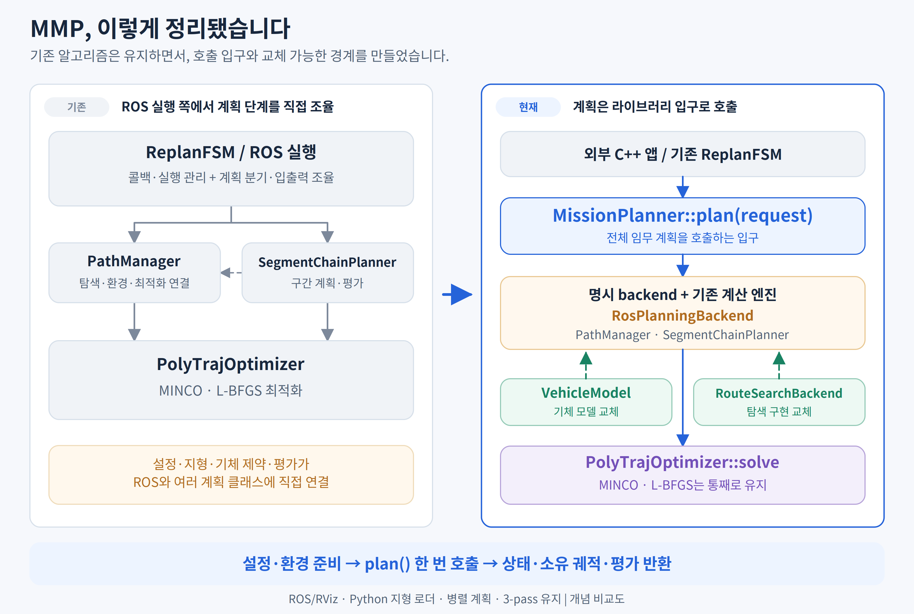

# 계획 계산의 단계적 모듈화

현재 API 사용법은 [계획 라이브러리 사용법](planning_library_usage_ko.md)을 참고한다.
이 문서는 변경 과정을 시간순으로 기록하므로 중간 단계의 `MissionPlanner(node)` 등
이전 API도 포함한다. 새 호출 코드는 현재 사용법과 최신 예제를 기준으로 작성한다.

2026-10-07. 기준: 상위 저장소 `lgh/dev`의 `531ebb7`, 계획 서브모듈
`mmp_dev`의 `ef4fc29`. 현재 체크아웃을 기준으로 하며 stash는 적용하지 않았다.

이번 목적은 ROS2 실행을 유지하면서 계산의 입력과 결과를 명확하게 만드는 것이다.
별도로 전달된 `cpp_library_architecture_ko.md`는 장기 설계 참고 자료다.
그 문서의 전면 C++ 포팅, SI 공개 API 전환, 시뮬레이터·지형 로더·시각화 분리는
이번 변경에 포함하지 않는다. 현재 구현의 경계와 값의 의미를 우선한다.

## 변경 전 호출과 책임

```text
RViz MissionConfig
  → Python /terrain/load_map: 미션 해석 + 회랑 로드
  → /planning/terrain_ready 확인 후 /mission/trajectory_command
  → ReplanFSM::trajectoryCommandCallback
    → startMissionPlan → triggerGlobalPlan
      ├─ SegmentChainPlanner::plan
      │   → commitRoute → PathManager::planGlobalTraj(front_end_only)
      │     → planFrontEnd (leg별 탐색과 기존 3-pass 정책)
      │   → planOverRoute
      │     → 경계조건 작성 → worker별 makeConfiguredOptimizer
      │     → 구간 solve → 실패 재시도 → 연결 → evaluateFlight
      └─ PathManager::planGlobalTraj
          → planFrontEnd → optimizeStage → PolyTrajOptimizer::optimizeFromPath
  → FSM이 기존 궤적 저장소를 읽어 발행·실행 상태 관리
```

이 그림은 기본 경로를 요약한다. transition/terminal과 direct fallback 분기는
각 coordinator에 남는다. 병렬 구간 수와 위험 회피의 3-pass는 서로 다른 개념이다.

| 함수 | 입력 | 현재 출력·부수효과 | 분리 방향 |
|---|---|---|---|
| `trajectoryCommandCallback` | ROS 미션, 순서·임무 ID | 단위 변환, 상태 채택/롤백, 계획 호출 | ROS 어댑터에 유지 |
| `startMissionPlan` | 명령 또는 현재 궤적, 목표·waypoint | 출처가 포함된 `StartHead`, marker, 계획 호출 | 새 임무/재계획의 시작 상태 의미 유지 |
| `triggerGlobalPlan` | 준비된 head/waypoints/tail | chain/direct 선택, `PlanResult`, FSM 전환 | 구간 계산 검증 후 계산 진입점 분리 |
| `SegmentChainPlanner::plan` | `StartHead`, waypoints, `TailBoundary` | 상태·이유, manager 궤적, 내부 평가·phase 상태 | 이후 소유하는 미션 결과로 묶기 |
| `commitRoute` | head, waypoints, 실행 모드 | route, cap, edge-leg, epoch, 탐색 시간 | 경로와 provenance를 함께 반환하도록 개선 |
| `planOverRoute` | route/cap/provenance, head/tail, 선택적 transition | 구간 작성·병렬 계산·retry·stitch·평가·저장·시각화 | 각 책임을 작은 단계로 분리 |
| `makeConfiguredOptimizer` | node 설정과 manager 환경 | 독립 optimizer; 환경 callback은 빌림 | 현재 환경/설정 연결 어댑터로 유지 |
| `solveSlice` | route/cap, head PVA, goal/tail, 정책, 숨은 manager 설정 | `bool` + 출력 궤적 | 첫 단계: 명시적 요청/설정 → 소유하는 결과 |
| `optimizeFromPath` | 가변 route, 경계조건, 속도·cap·leg 정보 | seed/최종 궤적, bool, optimizer 진단 상태 | MINCO/L-BFGS 및 판정 규칙 재사용 |

## 첫 구현의 계약

기존 `path_manager_lib`에 `solveRouteSlice`를 추가한다. 새 패키지와 알고리즘 사본은
만들지 않는다. `PathManager::solveSlice`는 기존 호출자를 위한 전달 어댑터로 남고,
구간 planner의 worker·출발/도착 재시도·병합 재시도는 새 함수의 결과를 소비한다.

| 값 | 내용 | 수명·의미 |
|---|---|---|
| `RouteSliceRequest` | path/cap, head 위치·속도·가속도, goal, 기존 `TailBoundary`, crossing 억제 여부 | 요청이 값을 소유하며 solver에 값으로 전달; optimizer의 path 수정이 호출자의 입력을 바꾸지 않음 |
| `RouteSliceConfig` | max velocity, cap/floor headroom, ground height, altitude weight | 현재 manager 값을 한 번 복사; YAML 기본값을 새로 정의하지 않음 |
| `RouteSliceResult` | 상태, 최종 `poly_traj::Trajectory`, 성공 시 envelope peak | 궤적 조각·계수를 직접 소유; optimizer/manager/요청의 수명과 독립 |

상태는 성공, 두 점 미만의 경로, optimizer 실패를 구분한다. 기존 optimizer가 bool만
반환하므로 실패를 비수렴·충돌 등으로 추측해서 분류하지 않는다. 실패 결과의 궤적은
비어 있고, envelope 값은 성공한 계산의 측정값일 때만 사용한다. 이것은 **구간 결과**다.
한 구간의 실패가 곧 미션 실패는 아니며, 기존 retry/fallback이 미션 결과를 결정한다.
전체 미션의 `PlanResult::{outcome, reason, detail}`과 `SUCCESS/DEGRADED/FAILED`
정책은 그대로 유지한다.

환경은 아직 독립 입력 객체로 분리하지 않는다. `makeConfiguredOptimizer()`의
거리장 주소와 terrain/risk callback은 manager를 참조하므로, **계산 중에는 manager와
연결된 환경이 살아 있어야 한다**. worker는 각각 독립 optimizer를 사용한다.
node 파라미터 설정·worker 생성·파라미터 복구는 기존처럼 순차 수행하고, 그 뒤
계산을 병렬 실행하여 모두 join한다. 결과의 독립 소유권이 optimizer 자체의
독립 수명이나 환경 snapshot을 의미하지 않는다.

좌표·단위는 기존 planner 규약이다. 현재 배포 설정은 `1 u = 100 m`, `+x=북쪽`,
`+y=서쪽`, 속도 u/s, 가속도 u/s², 시간 s다. `ResolvedMission`의 AGL·SI 입력
해석과 변환은 기존 Python/panel/FSM 경로가 담당한다. 새 구간 함수는 이미 해석된
좌표를 받고 다시 AGL을 더하거나 SI로 변환하지 않는다. 기존 `poly_traj::Trajectory`
및 조각의 계수 순서·평가 함수를 재사용한다. ROS `start_time`과 trajectory ID는
기존 저장·실행 계층에서 관리한다.

반드시 유지하는 계산 차이:

- 구간의 scalar 고도 상한은 head/goal/path/cap 최댓값에 headroom을 더한다.
  `optimizeStage`의 `fe_raw_max_z_`를 가져와 통합하지 않는다.
- cap 길이 불일치의 기존 optimizer fallback 의미를 유지한다.
- `zoneAvoidPassNow() == 1`의 crossing 억제 의미와 적용 순서를 유지한다.
- 구간별 optimizer override와 manager의 slice 설정은 구분한다.
- retry의 envelope peak 판정은 같은 solve의 반환 snapshot을 사용한다.
- FSM의 ABORT 발행, 임무 시퀀스, 거절 시 롤백, 새 임무로 복구하는 동작은 유지한다.
  현재 없는 외부 취소 토큰 API를 이번 단계에서 새로 만들지 않는다.

## 변경 파일과 순서

1. 변경 전 컨테이너/RViz에서 R2 미션을 실행하고 발행된 입력·궤적·지형 receipt,
   planner 평가와 화면을 저장한다. 기존 테스트도 먼저 실행한다.
2. `include/path_manager/route_slice_solver.h`, `src/route_slice_solver.cpp`에
   값 계약과 기존 slice 계산을 분리한다.
3. `path_manager.h/.cpp`에 설정 snapshot과 기존 API 어댑터를 연결한다.
4. `segment_chain_planner.cpp`의 세 계산 호출부를 결과형으로 연결한다.
   분할·worker 생성·재시도·최종 판정 정책은 바꾸지 않는다.
5. `test/route_slice_solver_test.cpp`, `CMakeLists.txt`로 실제 계산 및 결과 수명
   테스트를 기존 테스트망에 등록하고 컨테이너에서 빌드한다.
6. 기존 테스트, R2 RViz 실행, 동일 입력의 계수·시간·PVA 비교를 반복한다.

## 검증 결과

`mmp_dev` 컨테이너의 `/ws`가 작업 저장소의 bind mount임을 확인하고,
`docker exec -u user`로 기존 Humble/install 환경을 사용했다. 변경 전에 실제
RViz의 Start와 Run 버튼으로 다음 미션을 실행했고, 변경 후 전체 실행 프로세스를
다시 띄워 같은 절차를 반복했다.

- 미션: `/ws/src/mmp_terrain/data/scenarios/missions/r2_ridge_crossing.yaml`
- 추가 장애물·위험영역 없음. 기존 설정 그대로 `author_from_route + parallel`.
- Python 로더가 생성한 회랑: `2804 × 4119`, 해상도 `30 m`.
- planner의 실제 실행 파일 해시가 변경 전후 다르고, 변경 후 `/proc/<pid>/exe`가
  새 install 실행 파일과 일치함을 확인했다.

| 비교 항목 | 변경 전 | 변경 후 |
|---|---:|---:|
| 병렬 구간 수 | 5 | 5 |
| 최종 다항식 조각 수 | 190 | 190 |
| 발행된 구간 시간 합 | 521.0625259429216 s | 동일 |
| 10,001점으로 평가한 3D 경로 길이 | 103.36650207694775 km | 동일 |
| 최종/참고 궤적 계수·구간 시간 | 기준값 | **모든 원소 정확히 동일** |
| 10,001개 동일 시점의 위치·속도·가속도 차이 | — | 모두 0 |
| chain 연결부 최대 PVA 오차 | 3.638e-12 (각 planner 단위) | 동일 |
| planner 전체 평가 | CLEAN, envelope 위반 0%, peak 98.3% | 동일 |
| dynamics follower | 최대 추종 오차 0.1 m, 위반 step 0 | 동일 |

입력 명령은 mission ID/sequence를 제외한 모든 필드, 환경은 지형 ingestion receipt와
장애물·위험영역 상태를 비교했다. 궤적 ID와 ROS 시작 시각은 수치 궤적 비교에서 제외한다.
실제 비교는 단순 도착점이 아니라 `order`, `duration`, `coef_x/y/z` 전체를 포함한다.
숫자 필드의 JSON SHA-256은 최종/참고 궤적 모두 전후 동일하다.

```text
8d87546a0f29e4b077feed67917ad7f11d498b158ef4ef845a3fa7c3f35f29e4
```

실제 R2가 생성된 상태에서 ROS 환경 갱신·복구도 전후 각각 실행했다.
동일한 빈 위험영역 재발행은 ABORT를 내지 않았다. 유효한 위험영역을 추가하면
현재 궤적 `id=1`에 `ACTION_ABORT / POLICY_UNEVALUATED`가 정확히 한 번 발행됐다.
영역을 비운 뒤 같은 미션 값에 새 ID/sequence를 보내자 `id=2`가 생성됐으며,
복구 궤적도 최초 결과와 모든 계수·시간이 같았다. 시험 후 위험영역은 빈 상태다.

빌드는 workspace 전체 탐색 없이 변경 패키지만 지정했다.

```bash
# 컨테이너 내부, /ws
source /opt/ros/humble/setup.bash
source /ws/install/setup.bash
CMAKE_BUILD_PARALLEL_LEVEL=4 MAKEFLAGS=-j4 colcon build --symlink-install \
  --base-paths src/mmp_path_planning/src/path_manager --packages-select path_manager
ROS_DOMAIN_ID=73 ctest --test-dir /ws/build/path_manager --output-on-failure
```

- 변경 전 등록 테스트 **13/13**, 변경 후 **14/14** 통과.
- 포함된 chain 변형 **71/71**, risk 시나리오 **154/154** 통과.
  병렬/순차, retry/fallback, 3-pass 정책 및 임무 시퀀스 회귀 검증을 포함한다.
- 새 `route_slice_solver_test`는 실제 최적화, 입력 불변, 기존 어댑터와 계수 일치,
  optimizer 재사용·실제 충돌 거절·객체 파괴 뒤 결과 수명, cap 불일치 fallback을
  검사한다. 실제 계산 동등성은 위 변경 전후 R2 비교로 별도 확인했다.
- 수동 `exec_abort_test`의 consumer/wire 검사 **21/21**이 전후 모두 통과했다.

기존 미등록 `fsm_scenarios_test`는 **변경 전부터 실패**한다. 기본 시작점 `(0,0,0)`,
속도 `150 m/s`인 합성 입력이 envelope 위반 `11430/30586 = 37.4%`로 현재 hard
ceiling `30%`를 넘는다. 첫 계획에서 거절되어 그 테스트의 후속 ABORT assertion에
도달하지 못한다. 원본 바이너리와 설정을 보존한 반복 실행도 같은 결과였고,
변경 후 실행에서도 같은 검사 실패가 재현됐다.
설정이나 판정 정책을 완화하지 않았으며, 실제 R2의 ABORT·복구 검증으로
실제 FSM 경로를 별도 확인했다.

실행 로그·JSON·비교기·RViz 화면은 세션의 호스트 `/tmp/mmp_modularization`에 보관한다.
컨테이너에는 같은 경로 아래 `baseline/`, `after/`에 원시 결과가 있다.
숫자 비교는 `comparison.json`, ABORT·복구 비교는 `abort_comparison.json`,
전체 평가·연결부 검사 로그 비교는 `evaluation_comparison.json`이다.
이 디렉터리는 임시 검증 산출물이며 제품 코드/설정의 일부가 아니다.

## 두 번째 구현: 전체 미션 라이브러리 진입점

구간 함수를 외부에서 직접 조합할 필요 없이 `MissionPlanner::plan(request)` 한 번으로
기존 전체 계획을 실행한다. 기존 `path_manager_lib`에 포함하며 새 알고리즘 사본은 없다.
객체가 PM·chain·optimizer의 초기화와 수명을 관리한다. ROS FSM도 같은 API를 호출한다.

```text
외부 C++ 호출자 또는 ReplanFSM
  → MissionPlanner::plan(MissionPlanRequest)
    → 입력 확인 + optimizer 지연 초기화 + formation 정보 전달
    ├─ SegmentChainPlanner::plan (기존 병렬/retry/fallback/3-pass)
    └─ planDirect → 기존 head/tail 검증 → PathManager::planGlobalTraj
    → MissionPlanResult (상태 + 소유하는 궤적/평가 snapshot)
```

| 공개 입력·함수 | 전달하는 내용 | 반환·책임 |
|---|---|---|
| `MissionPlanner(node, logger)` | 기존 YAML/NodeOptions 설정, 선택적 공유 logger | PM·chain 구성과 optimizer 수명을 소유; optimizer는 첫 계획 시 초기화 |
| `setTerrainData`, `setRiskZones`, 장애물 추가/초기화 | 기존 GridMap, 위험영역 값, 장애물 형상 | 기존 환경 연결을 사용; 새 복사/동시 갱신 정책 없음 |
| `MissionPlanRequest` | `StartHead`, waypoints, tail, start altitude 해석, formation, 양수인 선택적 manager override | 호출 시 값 복사; 호출자의 입력 불변 |
| `plan(request)` | 해석된 한 미션 | 기존 `SUCCESS/DEGRADED/FAILED`, reason/detail, 최종·참고 궤적, 평가/phase, ID/시각/환경 revision |
| `MissionPlanResult` | 내부 저장소에서 성공한 결과만 복사 | 궤적 계수·평가·phase를 직접 소유; planner 재사용/환경 변경/파괴 뒤에도 유효 |

`StartAltitude::ABSOLUTE`가 기본이다. `COMMAND_AGL`은 시작점만 현재 지형에 대해
기존 방식으로 변환하며 지형이 없으면 absolute로 유지한다. waypoint z는 기존처럼 AGL다.
FSM은 명령의 once-only AGL 처리와 재계획 시작 상태 샘플링을 계속 맡고,
이미 변환한 시작점을 ABSOLUTE로 전달한다. 단위 변환은 추가하지 않는다.

실패 결과는 최종/참고 궤적과 phase가 비어 있고 평가가 `evaluated=false`다.
기존 실행 슬롯의 이전 궤적을 새 실패 결과로 반환하지 않는다. PM 슬롯 보존·롤백·
ABORT 발행 정책은 그대로다. direct 모드는 기존에 별도 전체 비행 평가가 없으므로
성공해도 `evaluation.evaluated=false`이며, 새 평가 gate를 추가하지 않는다.
chain은 실제 마지막 평가와 그 평가에 사용한 phase를 함께 복사한다.
참고 궤적의 의미는 기존 방식에 따라 다르다: direct의 seed, baseline-chain의
최적화 baseline, route-chain의 연결된 전체 궤적을 그대로 반환한다.

계산 순서도 유지한다. `setFormationInfo`는 solve 전에, optimizer의 formation cost
전달은 기존처럼 성공한 solve 뒤에 수행한다. direct와 chain의 head/tail 정책을
임의로 합치지 않는다. 내부 저장소에 결과를 다시 저장하지 않으므로 trajectory ID가
중복 증가하지 않는다. 발행용 시각과 ID 변환은 기존 ROS 어댑터가 담당한다.

변경 파일과 적용 순서:

1. `flight_evaluation.h`로 기존 평가 값 형식을 이동하고 chain의 기존 중첩 이름은
   alias로 유지한다. 평가와 phase를 함께 저장한다.
2. `mission_plan.h`, `mission_planner.h/.cpp`에 요청/결과와 전체 계획 진입점을 만든다.
3. `replan_fsm.h/.cpp`에서 planner 생성·optimizer 초기화·direct 검증/dispatch를
   새 API로 옮긴다. callback·메시지 발행·실행 상태 전환은 FSM에 남긴다.
4. `test/mission_planner_test.cpp`에서 공개 API만으로 direct/chain 실제 계산,
   시작/끝 경계조건, AGL, 실패 후 재시도, 결과 소유권을 검증한다.
5. `examples/mission_planner_example.cpp`를 설치해 라이브러리 호출 사용법을 제공한다.
6. `path_planner`, `path_optimizer`, `path_manager`의 CMake에서 기존 공통 로그 헤더를
   공개 헤더가 참조하는 위치에 설치한다. 소스 트리 외부 소비자의 컴파일로 확인한다.

사용 형태는 다음과 같다. 구체적인 synthetic terrain/mission을 갖춘 실행 가능한 코드는
`src/path_manager/examples/mission_planner_example.cpp`다.

```cpp
#include <path_manager/mission_planner.h>

path_manager::MissionPlanner planner(node);  // 기존 YAML 설정을 가진 node
planner.setTerrainData(terrain);
path_manager::MissionPlanRequest request;
request.head = resolved_head;
request.waypoints = waypoints;
request.tail = final_boundary;
auto result = planner.plan(request);
if (result.hasTrajectory()) {
    auto position = result.trajectory.getPos(t_seconds);
}
```

```bash
# 컨테이너 내부, ROS/install 환경 source 후
ros2 run path_manager mission_planner_example \
  /ws/src/mmp_path_planning/src/path_manager/config/optimizer_params.yaml
```

설치한 라이브러리를 외부 CMake 프로젝트에서 사용할 때의 최소 연결도 확인했다.
공개 헤더와 target만 사용하며 소스 트리 include 경로를 추가하지 않는다.

```cmake
cmake_minimum_required(VERSION 3.16)
project(mmp_mission_consumer LANGUAGES CXX)
find_package(path_manager REQUIRED)
add_executable(mission_consumer main.cpp)
target_link_libraries(mission_consumer PRIVATE path_manager::path_manager_lib)
set_target_properties(mission_consumer PROPERTIES
  CXX_STANDARD 17 CXX_STANDARD_REQUIRED YES)
```

이 단계는 **전체 계획을 호출할 수 있는 라이브러리 API**를 제공한다. ROS 없는 라이브러리는
아직 아니다. 설정은 node, 지형 입력은 GridMap이고 내부 PM 시각화도 남아 있다.
FSM은 `legacyManager()`로 기존 실행/환경 callback의 저장소를 접근한다. 외부 사용 예제와
신규 테스트에는 이 접근이 없다. 인스턴스의 `plan`과 환경 갱신은 순차 호출해야 하며,
기존 내부 segment 병렬 실행은 유지된다. 취소 토큰이나 새 ABORT 정책은 도입하지 않았다.

### 두 번째 단계 검증

변경 직전 설치 바이너리와 설정을 보존한 뒤 RViz R2 임무를 다시 실행했다.
변경 후에는 새 바이너리 프로세스의 `/proc/<pid>/exe` 해시와 install 실행 파일이
일치함을 확인했다. 전후 각각 정상 실행과 ABORT 후 복구를 수행해 **4/4 계획이 성공**했다.
이는 이 미션의 검증 횟수이며 일반적인 임무 성공률을 추정한 수치는 아니다.

- 최종/참고 궤적 모두 190 pieces, 521.0625259429216 s로 전후 동일.
- 모든 시간·계수가 정확히 같고 10,001점 PVA 차이는 0. 숫자 SHA도 첫 단계와 동일.
- 5개 병렬 구간의 연결부 검증·전체 평가 로그 38줄이 timestamp 제거 후 동일.
- 실제 환경 갱신 ABORT의 ID/이유/발행 횟수, 새 임무 복구 동작과 복구 궤적도 동일.
- 등록 CTest **15/15**, chain **71/71**, risk **154/154** 통과.
  `exec_abort_test`도 **21/21** 통과했다. 기존 미등록 `fsm_scenarios_test`는 위에
  기록한 변경 전 envelope 37.4% 거절과 동일하게 실패한다. 이를 통과로 집계하지 않는다.

최초 비교 시 과거 root 소유 chain 로그 재사용 문제를 발견해 해당 최초 결과는
근거에서 제외했다. 생성 디렉터리 소유권 정리 후 전체 suite를 다시 실행했으며
chain은 새 로그를 쓰면서 실행됐다.

원시 로그와 결과는 호스트·컨테이너 `/tmp/mmp_modularization_stage2`에 보존한다.
`comparison.json`, `abort_comparison.json`, `evaluation_comparison.json`과
`baseline/`, `after/`의 실행 기록·RViz 화면을 함께 확인할 수 있다.

외부 소비자는 설치된 헤더·라이브러리·YAML만으로 configure/compile/link/run을
통과했다. 예제의 짧은 30 km 경로는 기존 auto-N 정책대로 direct fallback을 선택하여
`DEGRADED`를 반환했다. 최종 궤적 12조각, 149.433042 s, 전체 평가와 phase 1개를
받았으며 양 끝 위치·속도·가속도를 사용할 수 있었다. `/ws/src` include 없이 빌드된
컴파일 명령과 실행 기록은 같은 임시 디렉터리의 `consumer/`에 있다.
패키징 보완 뒤 재빌드한 최종 planner 바이너리 해시도 RViz 검증 바이너리와 동일하다.

정상 실행 외의 관찰 차이도 있다. 시작 상태가 없는 요청은 이제 optimizer를 먼저
초기화하지 않고 거절한다. optimizer 초기화 예외는 waypoint marker 준비 뒤에
반환된다. 실행 궤적 발행과 실패/롤백 판단은 유지하며, 이 두 경우의 진단·시각화
준비 순서를 완전히 동일하다고 주장하지 않는다.

## 세 번째 구현: 경로·배치 계산·궤적 연결 분리

전체 미션 API 안쪽의 `planOverRoute`를 다음 경계로 나눴다.

| 경계 | 입력 | 출력·소유권 |
|---|---|---|
| `commitRoute` | head, waypoints, 실행 방식 | `optional<CommittedRoute>`: path/cap/edge-leg/epoch/front-end 시간의 소유 값 |
| `prepareRouteWorkers` | junction contracts, 병렬/phase 설정 | 적용 profile과 독립 optimizer; 기존 속도 상한 조정 후 node 설정 복구 |
| `solveRouteSliceBatch` | 준비된 구간 요청, 독립 optimizer들, slice 설정, 실행 방식 | 입력 순서를 유지하는 구간별 궤적·수행 여부·시간; 전체 계산 시간 |
| `planRouteFallback` | head, waypoints, tail, 적용 override, fallback 사유 | 기존 hard-limit 보존·전체 평가·실패/완화 정책의 `PlanResult` |
| `stitchRouteFlight` | 성공한 구간 궤적과 phase 이름 사용 여부 | 소유하는 연결 궤적과 phase 목록 |
| `prependFlightPrefix` | 연결 결과, transition 궤적, 기존 접합 허용오차 | 접합 여부, PVA/jerk 측정값, 소유하는 전체 궤적과 시간 이동된 phase |

`CommittedRoute`의 epoch는 환경 snapshot이 아니라 기존 manager의 정책 캡처와
edge-leg를 연결하는 식별자다. transition으로 경로를 자르면 path/cap/edge-leg를 함께
교체하고 epoch를 유지한다. 기존 output-parameter API는 호환 어댑터로 남기며 실패 시
출력값 보존도 유지한다. 경로의 edge tag를 다항식 piece tag로 임의 변환하지 않는다.

배치 함수는 파라미터 변경·boundary 작성·jitter 정책·로그·재시도를 담당하지 않는다.
호출자가 모두 준비한 뒤 각 optimizer를 독점 사용하고, 모든 thread를 join한 다음
결과를 반환한다. 일부 구간 실패는 다른 구간 결과를 지우지 않는다. optimizer와 빌린
환경은 계산이 끝날 때까지 살아 있고 변경되지 않아야 한다.
기존 병렬 worker의 예외 정책도 유지한다: 예상하는 solver 거절은 결과값이고,
worker 내부의 예외는 현재까지 프로세스 종료를 일으킬 수 있다. 이를 자동 재시도로
바꾸지 않았다. thread 생성 실패 때는 이미 시작한 worker를 join한 뒤 예외를 전달한다.

`solve_ms`/batch wall 시간은 이제 준비가 끝난 입력의 실제 계산 구간을 측정한다.
기존 worker 시간에 섞여 있던 boundary 작성과 route 복사는 제외되므로, **계산값은
동일성을 검증하되 실행 시간 수치까지 동일하다고 비교하지 않는다**.

구간 연결·prefix 접합은 ROS/PM을 호출하지 않는 값 계산이다. 기존 PVA 허용오차,
NaN 거부와 jerk의 측정-only 의미를 보존했다. terminal 생성, 실패 시 저장소 무효화,
전체 평가, global→local 저장 순서와 시각화는 기존 coordinator 쪽에서 적용한다.
평가에 실패한 후보가 먼저 발행되는 경로를 만들지 않는다.

### 세 번째 단계 검증

- 컨테이너 패키지 빌드 통과, CTest **16/16** 통과.
- 신규 batch 테스트 **47개 검사** 통과: 실제 optimizer의 순차/병렬 결과 완전 일치,
  서로 다른 입력의 순서, 부분 실패·충돌 거절·skip, 입력 불변, 결과 수명 검증.
- chain **71/71**, risk **154/154**. chain 로그는 모두 이번 실행에서 새로 생성됨.
- 새 바이너리로 RViz R2 실행·ABORT 후 복구 모두 성공. 전 단계와 최종/참고 궤적의
  모든 계수·시간이 정확히 같고, 10,001점 PVA 차이는 0.
- 연결부·전체 평가 로그 38줄과 ABORT/복구 검사 결과도 이전 단계와 동일.
- 근거: 호스트·컨테이너 `/tmp/mmp_modularization_stage3`의 `after/`, `comparison.json`,
  `abort_comparison.json`, `evaluation_comparison.json`.

## 네 번째 구현: 재시도 후보와 순수 미션 자료형

첫 배치 분리를 검증한 뒤 같은 작업을 계속하여 재시도 내부도 나눴다.

| 함수·값 | 책임 |
|---|---|
| `selectMergeNeighbors` | phase 보호 경계를 제외하고 기존 순서로 이웃 후보 선택 |
| `prepareMergeRetry` / `MergeRetryCandidate` | 공유 junction 중복 없이 경로·cap을 결합하고 head/tail을 가진 소유 요청 작성 |
| `mergedRetryProfile` / `MergeRetryProfile` | 기존 profile 우선순위, hard maximum 최솟값, soft override 손실 메모 작성 |
| `preparePhaseRetry` / `PhaseRetryCandidate` | 새 junction·slices와 출발/도착 및 이웃의 두 계산 요청 작성 |
| `solvePhaseRetry` / `PhaseRetrySolution` | 기존 순서로 재계산하고 두 결과가 모두 받아들여질 때만 소유 결과 반환 |

후보 자체가 입력과 결과를 소유하므로, 절반만 성공한 후보가 현재 chain의 일부를
바꾸지 않는다. coordinator는 후보 선택·실행·성공 후 교체와 fallback 선택을 맡는다.
N=2 도착 재시도 금지, 출발은 edge→neighbor/도착은 neighbor→edge 단락 평가,
optimizer 구성 순서는 항상 edge→neighbor, 기존 envelope peak gate를 보존했다.
실패한 merge 후보에서 이미 누적된 soft-loss 메모도 지우지 않는다. 계산 시간의 의미를
새로 바꾸지 않았으며 phase-edge rescue의 시간은 기존처럼 최초 worker 측정값이다.

`TailBoundary`를 `path_optimizer/tail_boundary.h`로 옮겼다. 데이터 기본값·멤버 순서·
메서드·namespace는 원문 그대로이며 기존 optimizer 헤더도 이 헤더를 포함한다.
`mission_plan.h`는 optimizer 전체 구현 대신 순수 boundary/trajectory 헤더를 포함한다.
따라서 미션 요청·결과, 경로 값, 궤적 연결의 자료형을 다루는 소비자는 ROS 헤더를
포함할 필요가 없다. `MissionPlanner` 실행 어댑터와 optimizer 내부 ROS 연결은 유지한다.

### 네 번째 단계 검증

- optimizer/manager 컨테이너 빌드와 CTest **17/17** 통과.
- batch **47개**, 새 연결 계산 **13개** 검사, chain **71/71**, risk **154/154** 통과.
- 설치된 `mission_plan.h`, `committed_route.h`, `flight_assembly.h`를 Eigen와
  두 패키지 include 경로만으로 컴파일했다. 환경 include 변수를 제거했고 실제
  include trace에 `/opt/ros` 의존성이 없음을 확인했다.
- 외부 CMake 소비자의 configure/build/run 및 예제 수치가 두 번째 단계와 동일.
- 새 바이너리의 R2 실행·ABORT 복구 성공. 최종/참고 궤적 수치와 평가 로그는
  두 번째 단계와 정확히 같으며 10,001점 PVA 차이는 0.
- 이번 두 단계에서 `planOverRoute`의 본문은 948줄에서 523줄로 나뉘었다.
  줄 수는 주석을 포함한 함수 길이이며 라이브러리화 완료율을 뜻하지 않는다.
- 근거: 호스트·컨테이너 `/tmp/mmp_modularization_stage4`의 `after/`, `consumer/`,
  세 비교 JSON. 시험용 ROS/RViz 프로세스는 검증 후 종료했다.

## 다섯 번째 구현: 단일 최적화 계산의 값 경계

`optimizeStage`에서 계산과 실행 부수효과를 분리했다. 이미 있는
`PolyTrajOptimizer::optimizeFromPath`를 그대로 호출한다.

| 값·함수 | 입력 | 반환·책임 |
|---|---|---|
| `computeDirectAltitudeBand` | 경로, head/goal, denoise 전 최대 고도와 manager 설정 | z 하한/상한/가중치와 로그용 원래/복구 최대 고도 |
| `DirectTrajectoryRequest` | 소유하는 path/waypoints/cap/edge tags, PVA/tail, 계산된 고도 범위, seed 속도, crossing 억제 | 현재 planner 단위의 해석된 absolute 입력 |
| `solveDirectTrajectory` | 독점 사용 중인 configured optimizer, 요청 값 | 상태, 소유하는 seed/최종 궤적, optimizer가 수정한 경로, piece-leg |
| `PathManager::optimizeStage` | 기존 front-end 결과와 실행 상태 | 설정 snapshot·로그·시각·저장·ID·시각화 어댑터 |

직접 계획의 scalar ceiling은 denoise 전 최대 고도를 복구한다. slice 계산과 달리
cap reference 전체의 최댓값을 scalar ceiling에 넣지 않는다. 두 경로를 편의상 합쳐
고도 제한이 달라지는 변경은 하지 않았다. 고도 로그는 기존처럼 solve 전에 기록한다.

optimizer가 경로에 점을 삽입한 뒤 거절할 수 있다. 따라서 실패 결과에도 수정 경로와
piece-leg 진단값을 보존하여 adapter가 기존 인수·필드를 갱신한다. 이 값은 유효한 비행
결과가 아니다. 실패한 seed/최종 궤적은 빈 값이며 실행 저장소에는 저장하지 않는다.
성공 시 global 시각은 계산 전에, local 시각은 계산 뒤에 기록하는 기존 기준을 유지한다.

구간 계산과 배치 계산의 입력·결과 헤더도 optimizer를 전방 선언하도록 바꿔,
계산 값만 사용하는 쪽이 optimizer의 ROS 헤더를 포함하지 않게 했다. 실제 optimizer
생성과 환경 연결은 여전히 기존 설정 어댑터가 맡는다.

### 다섯 번째 단계 검증

- 컨테이너 패키지 빌드와 CTest **18/18** 통과. 새 직접 계산 테스트 **29개 검사**,
  batch **47개**, 연결 **13개**, chain **71/71**, risk **154/154** 통과.
- 외부 CMake 소비자에서 chain을 끈 직접 계획과 기본 설정의 단일 fallback을 실행했다.
  두 모드 모두 변경 전과 최종/seed 궤적의 전체 double 계수·시간·PVA, 상태·phase·
  평가·ID가 정확히 일치한다. 실행 시각만 비교에서 제외했다.
- 설치된 공개 자료형 헤더 6개를 Eigen와 manager/optimizer include 경로만으로
  컴파일했다. 실제 include trace에 ROS 헤더가 없다.
- 새 바이너리의 RViz R2 실행·ABORT 후 복구 성공. 190 pieces, 521.0625259429216초,
  최종/참고 계수 및 10,001점 PVA 차이 0. 연결부·전체 평가 로그 38줄도 동일하다.
- 별도 ABORT 테스트 **21개 검사** 통과. 미등록 `fsm_scenarios_test`의 기존 실패는
  그대로 재현됐다: 합성 임무의 envelope 위반 37.4%가 기존 30% 거부 기준을 넘어
  첫 궤적을 발행하지 않는다. 이 실패를 통과로 계산하거나 허용 기준을 바꾸지 않았다.
- 근거: 호스트·컨테이너 `/tmp/mmp_modularization_stage5`의 `after/tests/summary.json`,
  `consumer/after_summary.json`, 세 비교 JSON 및 `after/rviz_r2.png`.
  실행한 planner의 `/proc/.../exe` 해시와 설치 바이너리 일치도 기록했다.

## 여섯 번째 구현: 미션 기하 준비와 공개 헤더 경계

`planGlobalTraj` 안의 AGL 해석과 탐색 범위 계산을 분리했다. 탐색기의 live policy
상태를 옮기기 전에, 이미 값으로 정의할 수 있는 계산을 먼저 분리했다.

| 대상 | 입력 | 결과·남기는 책임 |
|---|---|---|
| `resolveMissionWaypoints` | 시작점 이후의 waypoint 값, junction 여부, 최소 AGL, 동기 지형 조회 | 소유하는 absolute waypoint와 기존 로그에 필요한 변환 정보 |
| `computeMissionBounds` | absolute 시작/waypoint, 위험영역 값, headroom·수직 비율, 동기 지형 조회 | 소유하는 하한/상한과 포함 영역·지형 최고값 등 진단값 |
| `PathManager` 어댑터 | 위 결과 | 기존 로그, terrain 범위 경고, SDF 생성·대기 장애물 적용, 탐색·policy epoch 유지 |
| `MissionPlanner` 공개 헤더 | 기존 node/GridMap 어댑터와 순수 미션·위험영역 값 | PM·optimizer·탐색기 구현 헤더를 전방 선언으로 대체 |

지형 조회는 함수가 반환하기 전까지 빌리며 결과에 callback을 보관하지 않는다.
호출 중 환경을 갱신하지 않는 기존 직렬 계약을 따른다. live searcher의 visibility와
leg policy 캡처는 계속 PM에 남는다. `CommittedRoute::epoch`와 미션 결과의 환경 revision은
환경 사본이 아니며, 나중에도 그 비행이 유효하다는 보증을 뜻하지 않는다.
환경 변경 후 실행 중단·재검증·ABORT 발행은 기존 실행 어댑터 책임이다.
요청의 양수 manager override는 기존처럼 planner 인스턴스에 남으며, 이후 요청의
0 이하 값은 이전 설정을 유지한다. 요청별 임시 override로 의미를 바꾸지 않았다.

기존 코드에서 확인한 아래 동작도 바꾸지 않는다.

- 상한 z는 waypoint 전체의 최대값이 아니라 시작 z와 샘플링한 지형 최고값에
  headroom을 더한다. 기존 주석의 의도와 달라도 이번 변경에서 보정하지 않는다.
- 위험영역 포함의 fixpoint를 먼저 구하고, 포함된 최대 reach로 point margin을
  확장한다. 마지막 확장 뒤 위험영역 fixpoint를 다시 실행하지 않는다.
- AGL과 지형 최고값 계산은 서로 다른 기존 invalid 기준을 사용한다.
  지형 샘플 순서와 offset=0의 중복 조회까지 유지한다.

변경 파일은 `mission_geometry.h/.cpp`, `risk_zone.h`, `path_manager.h/.cpp`,
`mission_planner.h/.cpp`와 명시적 include가 필요한 소비자, 신규 기하 테스트 및
`CMakeLists.txt`다. Eigen만 연결한 계산 테스트, 기존 전체 회귀, 설치 API의 외부
소비자 비교, 실제 RViz R2와 ABORT 복구 순서로 검증한다.

### 여섯 번째 단계 검증

- 컨테이너 빌드 통과, CTest **19/19** 통과(76.86초). 새 기하 테스트 **26개 검사**,
  chain **71/71**, risk **154/154** 통과. chain 기록은 모두 이번 실행에서 생성됐다.
- 설치된 공개 자료형·계산 헤더 8개를 ROS include 없이 컴파일했다.
  `mission_geometry.cpp`와 그 테스트를 설치 헤더와 Eigen만으로 별도 컴파일·실행해
  26개 검사가 통과했으며, 실제 include trace에도 ROS 의존성이 없었다.
- `MissionPlanner`만 포함하는 별도 소비자는 기존 ROS/공개 target 설정으로 컴파일됐다.
  include trace에서 PM·`PolyTrajOptimizer`·`dyn_a_star`·SDF 헤더가 제거됐음을 확인했다.
- 외부 CMake 소비자의 직접 계획과 기본 fallback은 다섯 번째 단계와 최종/seed 전체
  double 계수·시간·PVA·상태·phase·평가·ID가 정확히 같았다. 실행 시각만 제외했다.
- 새 planner 실행 파일로 RViz R2 및 ABORT 후 복구 성공. 190 pieces,
  521.0625259429216초, 최종/참고 계수와 10,001점 PVA 차이 0을 유지했다.
  평가 로그 38줄과 AGL/탐색 범위 로그 6줄도 두 번째 단계와 정확히 같았다.
- 동일 환경 재발행은 ABORT 없음, 환경 변경은 정확한 ID로 ABORT 한 번,
  새 임무는 새 ID로 같은 궤적을 반환했다. 시험용 ROS/RViz 프로세스는 종료했다.
- 근거: 호스트·컨테이너 `/tmp/mmp_modularization_stage6`의 `after/tests/summary.json`,
  `consumer/after_summary.json`, `comparison.json`, `abort_comparison.json`,
  `evaluation_comparison.json`, `geometry_comparison.json` 및
  `after/rviz_r2_recovered.png`. 단계별 원본과 바이너리 해시도 보존했다.

## 일곱 번째 구현: 탐색 경로 후처리의 계산 경계

탐색·3-pass·leg policy 캡처는 현재 manager에 두고, 탐색 후 경로를 다듬는 계산을
`route_postprocessing.h/.cpp`로 분리한다. 기존 `IDistanceField` 인터페이스와 지형
조회 함수를 재사용하며 환경 구현을 복제하지 않는다.

| 계산 | 입력 | 소유하는 반환 값 |
|---|---|---|
| `roundRouteCorners` | `TaggedRoute`의 점·edge-leg, 반경, 동기 후보점 허용 판정 | 모서리 곡선이 적용된 점·edge-leg |
| `prepareRouteProfile` | 태그가 붙은 경로, absolute 시작·waypoint, 길이·이격 설정, 지형·거리장 조회 | 필터 경로, 최적화 경로·cap·edge-leg, 필터 전 최대 z와 진단값 |

`PathManager`는 기존 SDF/risk 허용 판정을 넘기고, 계산 후 기존 로그와 ROS 발행을
수행한다. 모서리 처리 직후의 front-end path/tube는 **고도 필터 전에** 발행한다.
필터·세분화 이후의 pipeline debug 발행과 두 점 미만 경로 거부 위치도 유지한다.

보존하는 세부 계약:

- 모서리 후보는 기존 순서로 반경을 절반씩 줄여 시도한다. 정책 leg가 바뀌는
  junction에는 중간 정점을 만들어 들어오는 구간과 나가는 구간의 태그를 보존한다.
- 모서리의 장애물 판정은 기존 `< clearance`다. 고도 필터는 유한 거리이면서
  `>= clearance`여야 변경을 허용한다. NaN/무한대의 서로 다른 의미를 합치지 않는다.
- 필터는 원래 z 배열의 이동평균을 사용하며 양 끝점은 고정한다. 지형이 없는 것과
  지형 조회가 invalid인 것은 다르며, 후자에만 기존 물 위 최소 고도를 적용한다.
- scalar 복구용 `raw_max_z`는 필터 이전 값이고, vertex cap은 `max(raw, filtered)`다.
  세분화에서는 경로·cap·edge-leg를 같은 순서와 보간식으로 함께 작성한다.
- 태그 길이 불일치의 기존 profile 동작은 계산을 계속하고 provenance만 비우는 것이다.
  새 공개 모서리 함수의 활성 fillet에 잘못된 태그를 주는 경우만 방어적으로 거절한다.
  기존 활성 fillet은 이 경우 범위 밖 접근이었고, 정상 production 입력은 길이가 맞는다.

변경 파일은 새 계산 헤더·소스, `path_manager.cpp`, 신규 순수 계산 테스트 및
`CMakeLists.txt`다. 수정 전 설치 바이너리의 R2를 다시 실행하여 최종 궤적뿐 아니라
`/planning/front_end_path`와 `/viz/front_end_path`도 추가 기록한 뒤 변경 후 비교한다.

### 일곱 번째 단계 검증

- 컨테이너 빌드 통과, CTest **20/20** 통과(77.96초). 새 후처리 테스트 **31개 검사**,
  chain **71/71**, risk **154/154** 통과. chain 기록은 모두 새 실행이다.
- 공개 헤더 9개 ROS 없이 컴파일 성공. 후처리 소스·테스트는 설치된 manager/planner
  헤더와 Eigen만으로 별도 컴파일·실행해 31개 검사가 통과했고 ROS include가 없었다.
  기존 기하 계산 26개 검사와 facade 헤더 의존성 검사도 통과했다.
- 외부 CMake 소비자의 직접 계획·기본 fallback은 여섯 번째 단계와 모든 궤적 계수·
  시간·PVA·상태·phase·평가가 일치했다. 실행 시각은 비교에서 제외했다.
- R2의 최종/참고 궤적은 190 pieces, 521.0625259429216초로 그대로이며 전체 계수와
  10,001점 PVA 차이는 0이다. 추가 기록한 180개 front-end 정점과 경로 tube 메시지도
  ROS header 시각을 제외한 모든 필드가 정확히 같다.
- 필터·세분화 로그 2줄, 전체 평가 로그 38줄이 동일하다. R2 ABORT 후 새 ID 복구와
  복구 궤적 수치 일치도 통과했다. 시험용 ROS/RViz 프로세스는 종료했다.
- 근거: 호스트·컨테이너 `/tmp/mmp_modularization_stage7`의 `after/tests/summary.json`,
  `consumer/after_summary.json`, `comparison.json`, `frontend_comparison.json`,
  `abort_comparison.json`, `evaluation_comparison.json`, `postprocessing_comparison.json`.

## 여덟 번째 구현: 경로 준비 결과의 소유권

기존 `planGlobalTraj`의 공통 준비 처리를 실제 공유 함수로 옮긴다. 단순히 기존 bool
호출 뒤 getter 네 개를 읽는 wrapper를 추가하지 않는다.

| 함수·값 | 입력 | 반환·책임 |
|---|---|---|
| private `prepareRoute` / `PreparedRoute` | head, 명령 waypoint, junction 여부, 선택적 기존 route/cap/provenance | absolute waypoint, 소유 `CommittedRoute`, 필터 전 최대 z, 기존 전체 시간 측정 시작점 |
| private `planFrontEnd` | absolute 시작/waypoint, takeoff 여부 | 기존 소유 `RouteProfileResult` 또는 실패; 검색·정책 캡처·발행 순서는 유지 |
| `PathManager::planCommittedRoute` | head와 명령 waypoint | 최적화 없이 소유 경로 결과 또는 실패 |
| 기존 `planGlobalTraj` | 기존 입력·override·front_end_only 계약 | 같은 준비 결과를 받아 head 정책과 단일 최적화 어댑터 실행 |
| `SegmentChainPlanner::commitRoute` | 기존 입력 | manager의 결과를 직접 받아 반환, 기존 바깥 시간 측정 유지 |

`fe_raw_max_z_` 임시 멤버를 없애고 같은 준비 결과의 값을 최적화 어댑터에 명시적으로
전달한다. 경로·cap·tag의 기존 호환 캐시는 optimizer가 경로를 수정하기 전에 복사한다.
준비 실패에서는 현재 호출의 캐시가 비고, 최적화 실패에서는 성공한 준비 결과의 캐시가
남는 기존 비대칭 동작을 유지한다. 입력 거절은 policy epoch를 증가시키지 않으며,
실제 탐색에 들어갔을 때만 epoch가 증가한다. 상속 경로의 짧은 override는 기존처럼
재탐색하고, stale provenance는 geometry를 거부하지 않고 귀속 정보만 비운다.

SDF 생성과 대기 장애물 적용은 기존 순서대로 실행한다. 그 과정의 이전 비행 재검증·
ABORT를 결과 생성 성공 여부에 따라 취소하거나 rollback하지 않는다. 소유 경로는
독립 데이터지만 epoch가 가리키는 정책은 계속 현재 manager에 종속된다.

변경 파일은 `path_manager.h/.cpp`, `segment_chain_planner.cpp`, 새
`committed_route_test.cpp`, `CMakeLists.txt`다. 경로-only API의 입력 거절·소유권·
실행 저장소 불변·policy 수명, 기존 회귀와 외부 소비자, R2/ABORT를 단계별로 검증한다.

### 여덟 번째 단계 검증

- 컨테이너 빌드 통과, CTest **21/21** 통과(78.40초). 새 경로 준비 테스트 **34개 검사**,
  chain **71/71**, risk **154/154** 통과. 반환 결과의 재사용·실패·manager 파괴 이후
  수명과 기존 실행 저장소 보존을 검사했다.
- 외부 소비자의 직접 계획·기본 fallback은 일곱 번째 단계와 모든 궤적 수치·상태·
  평가가 같다. 공개 CMake target에 `cxx_std_17`을 내보내도록 명시했고 소비자에서
  이를 확인했다. ROS 없는 공개 헤더·기하 계산·경로 후처리 검사도 통과했다.
- RViz에서 같은 R2 임무를 로드해 실행했다. 190 pieces, 521.0625259429216초이며
  전체 계수와 10,001점 PVA 차이는 0이다. front-end path/tube도 header 시각을
  제외하고 정확히 같다. 필터 로그 2줄과 평가 로그 38줄도 일치한다.
- 동일 환경 재발행에는 ABORT가 없고, 정책 변경에는 해당 ID의 ABORT가 정확히
  한 번 발생했다. 같은 임무를 새 ID로 복구한 궤적도 수치가 같다.
- 근거는 호스트·컨테이너 `/tmp/mmp_modularization_stage8`의 `after/tests/summary.json`,
  `consumer/after_summary.json`, `comparison.json`, `frontend_comparison.json`,
  `abort_comparison.json`, `evaluation_comparison.json`, `postprocessing_comparison.json`.
  검증 집계기의 CTest 공백 파싱 오류를 수정했으며 초기 집계 기록도 별도 보존했다.

## 아홉 번째 구현: 최적화의 구간별 비용 프로필

`PolyTrajOptimizer::optimizeFromPath` 안의 실제 고도 상한 및 거칠기·시간 가중치
계산을 ROS 없는 `path_optimizer/route_cost_profile.h/.cpp`로 옮긴다.
전체 최적화는 기존 `MissionPlanner::plan`과 직접/구간 solver 경계로 계속 호출한다.
이번 분리는 그 호출 아래의 복잡한 내부 계산을 재사용 가능한 함수로 만드는 단계다.

| 함수 | 입력 | 소유 결과 |
|---|---|---|
| `buildPieceAltitudeCaps` | 확정 경로·cap reference, 순서가 유지된 zone 중심/반경, 설정, 지형·shadow 조회 | 구간별 고도 상한, 활성/기준 불일치 상태, 기존 로그용 통계 |
| `buildPieceRoughness` | 확정 경로, relief/ride/지형 셀 설정, 지형 조회 | 구간별 거칠기·시간 가중치, 활성 상태, 기존 로그용 통계 |

환경 함수는 동기 호출 동안 const reference로 빌려 stateful callback의 복사를
피한다. 결과는 환경 함수를 보유하지 않는다. optimizer는 기존 시점에 이전 구간 배열을
비우고 반환 배열을 채택한다. H4 확정 고도는 두 계산 전, H4 진단은 두 계산 사이에
유지하며 MINCO seed·L-BFGS·재시도·평가·병렬 worker 상태는 그대로 둔다.

보존할 계약에는 XY 거리 기반 두 방향 slope envelope, swath의 샘플 순서와 간격,
원본 zone index, shadow의 조기 거절이 포함된다. gradient 조회 실패 때 height 조회로
대체하지 않으며, height만 제공한 roughness는 기존처럼 0이다. 실패한 gradient 샘플도
거칠기 평균의 분모에는 포함한다. relief 설정의 clamp 위치도 변경하지 않는다.

변경 파일은 새 헤더·소스·순수 계산 테스트, `poly_traj_optimizer.cpp`, optimizer의
CMake·테스트 의존성이다. 독립 계산 검사 후 기존 전체 회귀·외부 소비자·R2/ABORT와
동일 입력 수치를 비교한다.

### 아홉 번째 단계 검증

- 컨테이너에서 optimizer와 manager 빌드 통과(25.2초). manager CTest **21/21**
  (78.30초), optimizer CTest **1/1** 통과. 새 계산 테스트 **28개 검사**와
  기존 chain **71/71**, risk **154/154**가 통과했다. 새 실행 로그임도 확인했다.
- 열 개의 계산/값 공개 헤더에서 ROS include가 없음을 확인했다. 새 계산 함수의
  실제 소스와 테스트를 설치 헤더·Eigen만으로 독립 컴파일하고 28개 검사를 통과했다.
  callback 원본 객체의 상태가 갱신되는지, 결과가 callback을 보유하지 않는지도 검사했다.
- 외부 CMake 소비자의 직접 계획·기본 fallback 결과는 여덟 번째 단계와 전체 궤적
  계수·시간·PVA·상태·phase·평가·ID가 같다. 실행 시각만 비교에서 제외했다.
- 새 설치 바이너리로 RViz R2를 로드·실행했다. 190 pieces, 521.0625259429216초,
  최종/참고 궤적의 전체 계수와 10,001점 PVA 차이가 모두 0이다. front-end path/tube도
  시각을 제외하고 동일하다. 평가 38줄·후처리 2줄 및 cap 통계 10줄도 일치했다.
  병렬 worker의 cap 로그는 출력 순서 대신 내용별 개수로 비교했다.
- 실제 ABORT는 변경된 정책에 대해 정확한 ID로 한 번 발생했고, 복구 궤적은 새 ID와
  동일 수치를 갖는다. 시험용 ROS/RViz 프로세스는 종료했다.
- 근거는 호스트·컨테이너 `/tmp/mmp_modularization_stage9`의 `after/tests/summary.json`,
  `consumer/after_summary.json`, `comparison.json`, `frontend_comparison.json`,
  `abort_comparison.json`, `evaluation_comparison.json`, `cost_profile_comparison.json`.
- 마지막으로 공개 optimizer 헤더의 오래된 tail 설명을 실제 `TailBoundary` flag
  의미에 맞췄다. 이 설명 정정에는 실행 코드 변경이 없다.

현재 `MissionPlanner::plan(request)`로 전체 계획을 호출하며, 직접/병렬 구간 최적화,
궤적 조립, 미션 기하, 경로 후처리, 비용 프로필 계산에 명시적 입력·소유 결과 경계가 있다.
전체 라이브러리에는 아직 ROS 설정·환경 어댑터와 mutable optimizer session이 남는다.
통과한 회귀 검사 비율은 임의의 실제 임무 성공률이나 전체 ROS 제거율을 뜻하지 않는다.

## 최종 정리: 호출 가능한 라이브러리 경계

이번 범위의 완료 기준은 전체 ROS 제거가 아니라 다음 다섯 가지다.
전체 미션과 이미 준비된 경로의 최적화를 각각 공개 호출로 실행할 수 있고,
입력·설정·환경·결과의 소유권이 명확하며, 실제 ROS 실행도 그 결과를 소비해야 한다.
내부 계산은 작은 함수로 분리하되 기존 탐색·최적화 알고리즘과 판정 규칙을 공유한다.
마지막으로 설치된 라이브러리만 사용하는 외부 프로그램과 기존 실행 양쪽을 검증한다.

### 전체 미션과 최적화 세션

| 진입점 | 호출자가 준비할 것 | 반환과 수명 |
|---|---|---|
| `MissionPlanner::plan(MissionPlanRequest)` | 기존 ROS node 설정, GridMap/위험영역/장애물 환경, 출처 있는 초기 상태와 임무 | 상태·실패 사유, 최종/참고 궤적, 평가·phase·기존 ID/시간을 소유 |
| `PolyTrajOptimizer::solve(OptimizerSolveRequest)` | `setParam`의 수치 설정, `OptimizerRuntimeSettings`, `OptimizerEnvironment`, 확정 경로와 경계조건 | 성공 시 seed/최종 궤적·envelope, 성공/실패 모두 진단 경로·piece 귀속을 소유 |
| `PathManager::planCommittedRoute` | 현재 탐색 환경과 head/waypoint | 최적화 이전의 경로·cap·edge-leg·epoch를 소유 |

`OptimizerRuntimeSettings`는 기존 manager factory의 설정 묶음이다. 수백 개 수치
파라미터를 다시 복제한 두 번째 설정 체계가 아니다. `setParam`은 기존 ROS 설정
어댑터로 남는다. 단독 optimizer에서도 `alt_cap_headroom` override가 읽히도록
이미 선언된 이름은 유지하고, 없을 때만 기존 기본값으로 선언한다.

`OptimizerEnvironment`는 거리장 포인터, 지형 높이/gradient 함수·셀 간격,
순서 있는 위험영역과 visibility/shadow 함수를 묶는다. zone과 함수 객체는 소유하지만
함수가 참조하는 데이터와 거리장은 빌린다. 동일 optimizer의 재설정과 계산은 순차로
수행하고, 병렬 계획은 기존처럼 서로 다른 optimizer를 사용한다. risk-only 갱신은
지형 연결을 지우지 않는다. 빈 전체 환경은 이전 연결을 해제한다.

새 `solve`는 짧은 경로·waypoint 없음·미초기화·잘못된 수치 입력·backend 실패를
구분한다. 수치 입력 거절은 per-plan 고도 대역/crossing 설정 변경이나 환경 조회보다
먼저 수행한다. 사용하지 않는 tail 값과 길이가 틀려 무시되는 cap은 기존 의미를 유지한다.
새 성공 결과만 seed/궤적/envelope를 내보내며, 실패가 이전 계산을 성공 결과처럼
돌려주지 않는다. 기존 low-level bool API도 호환용으로 남는다.

### 탐색과 ROS 연결

`searchMissionRoute`는 absolute waypoint와 동기 leg 탐색 함수를 받아 순서대로
호출하고, 중복점 제거·경로 연결·edge-leg 귀속을 한 소유 결과로 돌려준다. leg observer는
실제 탐색 직후, 다음 탐색 전에 실행한다. PM은 이 시점에서 기존 search count와
정책 snapshot/void latch를 처리하므로 3-pass와 epoch 의미가 유지된다.
`configureFrontEnd`와 `publishFrontEndRoute`는 각각 기존 환경/ROS 연결과 로그·발행을
담당한다. SDF 생성·대기 장애물 적용·ABORT hook은 기존 준비 단계에 남는다.

FSM은 성공한 미션 결과를 `pending_plan_`에 잠시 보관하고, 다음 발행 tick에서
`makeTrajectoryMessage`로 변환한 후 비운다. manager의 실행 슬롯은 계속 실행·무효화의
단일 기준이다. 발행 전에 ID와 유효 기간을 확인하며, ABORT나 emergency 교체 시
대기 결과를 폐기한다. 거절된 교체 명령은 앞서 성공한 대기 결과를 덮어쓰지 않는다.
local의 timestamp와 reference의 발행 시각·ID 0 규약도 그대로다.

### 최종 검수에서 발견하고 수정한 문제

- **인스턴스 간 지형 캐시 충돌:** 기존 thread-local 캐시가 각 객체의 generation과
  좌표만 비교하여 다른 지형의 값을 반환했다. 저장된 원본 TerrainData로 8개 실패를
  재현했다. 공개 generation은 유지하고 고유 객체 식별·valid 상태를 캐시 키에 더했다.
  복사/이동/대입/이동된 원본/주소 재사용까지 식별을 갱신하며 12개 검사를 추가했다.
- **optimizer 단독 링크:** LogManager 구현이 manager 라이브러리에만 있어 optimizer
  소비자가 숨은 manager 링크를 요구했다. 구현의 빌드 소유자를 optimizer로 옮기고
  공개 C++17 요구를 내보낸다. manager는 기존 optimizer 의존성을 통해 같은 구현을 쓴다.
- **ROS 변환의 임시 객체 수명:** 새 변환 코드에서 값으로 반환된 Piece의 내부 행렬을
  참조하던 오류를 교차 검수로 찾아 값 복사로 수정했다. 집중 ASan/UBSan 검사에 포함한다.
- **FSM 테스트의 시작 입력:** 기존 비등록 테스트는 지상 시작·150 m/s 입력에서
  계획이 먼저 거절돼 ABORT 시나리오까지 도달하지 못했다. 이전 바이너리의 실패를
  보관하고, 수평 비행 가능한 명시적 시작점을 사용하도록 fixture만 수정했다.
  terrain ABORT 이후 obstacle 검사에는 지형을 복구한다. 알고리즘/안전 gate를 완화하지
  않았다. 발행 전 결과 철회, 거절된 교체 후 정상 발행, 새 결과 복구 검사도 추가한다.

### 추후 ROS 분리에서 다룰 경계

이번 범위에서 유지한 부분은 ROS node의 수치 설정·로그/clock, GridMap 입력 어댑터,
환경 갱신과 시각화, 기존 실행 저장소와 재검증 연결이다. 이들은 다음 전면 포팅 때의
대상이며, 이번 라이브러리가 모두 ROS 독립적이라고 주장하지 않는다. 반환 결과의
소유권은 환경 snapshot이나 변경 후 계속 비행해도 된다는 보장을 뜻하지 않는다.
현재 시뮬레이터 전체 분리, Python 지형 로더 C++ 이식, 독립 시각화는 포함하지 않는다.


### 최종 검증 결과 (2026-10-08 KST)

최종 optimizer·manager를 `mmp_dev` 컨테이너에서 빌드했다. 최초 빌드의 manager
설정 오류는 중복된 `builtin_interfaces` 의존성 선언이 원인이었으며, 중복을 제거한
최종 빌드는 통과했다. 남은 경고는 기존 코드의 주석·미사용 인자·로그 문자열 길이
관련이며, 실패한 첫 빌드 로그도 보관했다.

| 검증 | 결과 |
|---|---|
| manager CTest | **26/26**, 98.54초 |
| optimizer CTest | **2/2**: 비용 프로필 28개·공개 세션 67개 검사 |
| 실제 chain / risk 시나리오 | **71/71**, **154/154**; 새 실행 로그임을 확인 |
| FSM / 실행 ABORT | 각각 **21개 검사**; 발행 전 철회·교체 거절·복구·late subscriber 포함 |
| 설치 target 외부 소비 | manager 단독 공개 진입점과 optimizer target 단독 링크·실행 통과; optimizer 링크에 manager 없음 |
| ROS 없는 계산 경계 | 공개 값/계산 헤더 13개 include 검사, 기하·후처리·비용 프로필·leg 연결 실제 소스 독립 컴파일/실행 통과 |
| 집중 메모리 검사 | 메시지 변환 7개·지형 memo 12개·leg 연결 14개를 ASan/UBSan으로 실행, 오류 없음 |
| 실제 RViz R2 | 임무·30m 지형 로드 후 최종/참고 궤적 발행 성공 |
| 최초 변경 전 R2와 직접 비교 | 두 궤적 모두 전체 wire 계수·구간 시간 및 10,001점 P/V/A 차이 **0** |
| 실제 R2 ABORT / 복구 | 기존 10개 조건 일치; 현재 ID에 정확히 한 번 ABORT, 새 ID 복구 궤적의 수치 동일 |

R2 결과는 190 pieces, 521.0625259429216초이며, 기존처럼 5개 병렬 구간으로
계획했다. front-end path/tube, 전체 비행 평가 38줄, 후처리 2줄도 직전 단계와
동일하다. cap 통계 10줄은 병렬 출력 순서에 영향을 받으므로 내용별 개수로 비교했다.
동역학 follower의 peak tracking error는 0.1m, envelope 위반 step은 0이었다.

외부 CMake 소비자는 설치된 `path_manager::path_manager_lib`만 연결하고 실제 Python
지형 로더에서 같은 R2 GridMap을 받아 `MissionPlanner::plan`을 호출했다. FSM이나
`legacyManager()` 없이 5개 phase의 전체 궤적·평가를 반환했고, planner와 node를
파괴한 후에도 결과를 직렬화했다. 라이브러리 결과의 원본 double 계수는 별도 보관하고,
기존 `PolyTraj`의 float32 계수·구간 시간 규약으로 변환한 값이 RViz 기준과 정확히
같음을 확인했다. 단순 double 대 wire float 비교를 알고리즘 차이로 계산하지 않았다.
직접 계획·기본 fallback 소비자의 계수·시간·PVA·상태·평가·ID도 직전 단계와 같다.

설계와 패키징을 독립적으로 재검수했다. 새 API가 실제 ROS 경로에서 사용되고,
계산 함수가 별도 알고리즘 사본 없이 기존 backend를 공유하며, 반환 데이터의 수명과
환경 제공자의 수명이 구분됨을 확인했다. 공개 헤더의 예전 zero-tail 설명과 README의
namespace 오기도 정정했다. 설치 target의 같은 환경 내 외부 소비는 검증했으나,
기존 SDF/CUDA 경로를 포함한 설치 prefix의 다른 머신 이전 가능성은 이번 범위 밖이다.

검증 근거는 호스트와 컨테이너의 `/tmp/mmp_modularization_final`에 보관한다.
주요 파일은 `after/tests/summary.json`, `consumer/after_summary.json`,
`r2_consumer/comparison.json`, `sanitizers/summary.json`, `original_comparison.json`,
`frontend_comparison.json`, `evaluation_comparison.json`, `abort_comparison.json`이다.
이 통과율은 명시한 회귀 검사에 대한 결과이며 임의의 새로운 임무의 성공 확률이 아니다.
전체 스택을 sanitizer로 빌드한 결과도 아니며, 위 세 개 신규 경계의 실제 구현을
instrument한 검사다. 시험을 위해 띄운 ROS/RViz/지형 로더 프로세스는 종료했다.

이번 계획 라이브러리화 범위의 완료 기준을 충족했다. 후속 전면 ROS 분리는
`setParam` 설정 어댑터, GridMap 환경 입력, 시각화·실행 저장소 연결을 순서대로
대체하는 별도 작업이다. 현재 API와 검증된 계산 경계는 그 작업의 기반으로 사용한다.


## 확장 단계: 교체 가능한 모델·탐색과 일반 입력 계약

2026-10-08. 사용자는 ROS/RViz 실행을 유지하면서 기체 모델과 탐색 구현을 교체할
수 있는 경계를 추가하도록 요청했다. Claude가 제안한 A→B→C 순서를 코드와 대조해
아래와 같이 보완했다. 기존 1~9단계와 최종 정리의 미커밋 변경 위에서 진행하며,
상위 `lgh/dev`·계획 서브모듈 `mmp_dev`를 유지한다.

- **A 기체 모델:** 수식은 이미 `mmp_vehicle_dynamics/flight_dynamics.cpp`에서 공유된다.
  남은 결합은 `Parameters` 및 정적 함수 호출, chain의 기하 feasibility 계산과
  고정익 전환 법칙이다. immutable 모델을 주입하고 비용의 정확한 PVA gradient,
  envelope/handoff 판정, 탐색·구간의 기하 제약, 전체 평가가 일관되게 사용하게 한다.
  기본 구현은 기존 자유함수에 위임한다. 새로운 비행 방식의 전환 법칙까지 자동으로
  지원한다고 약속하지 않으며, 기존 고정익 전환은 명시적 capability로 구분한다.
- **B 경로 탐색:** `searchMissionRoute`는 경로 점만 반환하는 기하 경계다. 실제 정책
  증명은 기존 searcher의 pass/noBarrier/softOverride를 따로 읽으므로 콜백 교체만으로
  충분하지 않다. 교체 backend는 소유 경로와 해당 환경·leg·epoch의 정책 정보를 함께
  반환한다. 미측정 정책은 UNKNOWN을 유지하며 기존 consumer별 거절/완화 규칙을 따른다.
  알고리즘 전용 옵션은 구현체가 소유하고, canonical 위험/충돌/ABORT 질의는 유지한다.
- **C 일반 입력:** `MissionPlanner`는 현재 생성자로 node를 받고 지형은 별도 setter로
  받는다. ROS 없는 설정·환경 값 계약과 명시적인 ROS 호환 어댑터를 구분하여 추가한다.
  내부 ROS node 생성을 감춘 것을 계산 전체의 ROS 제거라고 표현하지 않는다. 기존
  파라미터 이름·타입·우선순위·override 복구 및 환경 변경의 실행 철회 의미를 보존한다.
- 현재 기본 follower는 `shared_3dof`의 C++ `dynamics_sim_node`다. Python binding과
  과거 follower 설명은 별도로 존재한다. 이번 단계에서는 follower를 수정하지 않는다.

확장 전 소스 106개 및 설치 바이너리/라이브러리/YAML을
`/tmp/mmp_modularization_ext_baseline`에 보존했다. CTest 28/28, chain 71/71,
risk 154/154와 외부 직접/default/optimizer 소비자가 통과했다. 실제 R2 라이브러리
결과는 이전 최종 결과의 원본 double 값 전체와 같았다. 별도 RViz R2 실행도
최종/참고 wire 궤적이 정확히 같았고, 실제 ABORT와 새 ID 복구까지 통과했다.
단계별 구현 후 같은 입력 비교와 실행 철회 검증을 반복한다.

### 확장 중 추가 범위 지시

사용자는 MINCO·L-BFGS 본체를 분해하지 않고 `PolyTrajOptimizer::solve` 경계 안에서
하나의 최적화 라이브러리 단위로 유지하도록 명시했다. 따라서 앞선 구조 그림의
추가 제안 중 optimizer 내부 seed/solve/audit 흐름을 더 쪼개는 작업은 수행하지 않는다.
A→B→C 순서는 유지하며, 비용 프로필과 VehicleModel 주입, 설정·환경 입력 등 바깥
경계를 정리한다. 기존 비용·평가의 모델 함수 호출을 주입 경계로 바꾸되, MINCO 생성과
L-BFGS 루프·미분 누적 순서·판정 수치·최적화 알고리즘 자체는 유지한다.

### 확장 A 완료: 공유 VehicleModel

`mmp_vehicle_dynamics::VehicleModel`은 immutable `shared_ptr<const ...>` 계약이다.
SI PVA를 받아 평가·정확한 비용 gradient·envelope/handoff 판정·필요 기하 한계를
반환한다. 기본 `FixedWingModel`은 기존 자유함수에 그대로 위임한다. 명시 주입 시
PathManager, 모든 병렬 worker, optimizer 비용/감사 및 chain 최종 평가가 같은 객체를
사용한다. 모델 변경은 실행과 worker가 끝난 임무 사이에 직렬로 수행한다. 완료된
worker와 반환 궤적은 자신의 수명을 유지하며 나중 교체의 영향을 받지 않는다.

기존 고정익 전환은 별도 capability를 요구한다. 이를 제공하지 않는 모델에 기존
전환 법칙을 몰래 적용하지 않는다. 현재 상태 표현을 넘어선 VTOL 전환이나 follower
교체를 구현한 것은 아니다. 기본 ROS 물리 설정의 구간별 override/복구와 탐색 시
live FPA 읽기는 유지한다. 잘못된 모델 또는 잘못된 기본 설정으로의 reset은 교체
전에 거절하고 기존 모델·활성 상태를 보존한다. 명시적인 dynamics 비활성화도
유효 모델 주입으로 뒤집지 않는다.

주요 변경은 vehicle_model.hpp/.cpp, optimizer의 모델 결합, PathManager의 factory와
handoff/전단 제약, SegmentChainPlanner의 기하·전환 지원 확인·최종 평가, facade의
`setVehicleModel`이다. MINCO 생성, L-BFGS 루프, gradient 누적 순서는 그대로다.

검증 (`/tmp/mmp_modularization_ext_a`, 호스트 및 컨테이너):

| 항목 | 결과 |
|---|---|
| 관련 3개 패키지 컨테이너 빌드 | 성공 |
| CTest | 33/33 (manager 26, optimizer 2, vehicle 5) |
| chain / risk 개별 재실행 | 71/71, 154/154 |
| 설치 target 외부 교체 모델 소비자 | 47개 검사 통과; 병렬 호출·모델 동일성·reset·수명·미지원 전환 포함 |
| 직접/default/R2 라이브러리 결과 | 확장 전 원본 double 결과와 동일 (실행 시각 제외) |
| 실제 RViz R2 | 최종/참고 wire 계수·구간 시간, 전단 경로 동일 |
| 실제 ABORT / 새 ID 복구 | 통과; 복구 궤적 수치 동일 |
| 전체 평가 / 후처리 / 비용 프로필 로그 | 38줄 / 2줄 / 10줄 동일; 병렬 비용 로그는 내용별 개수 비교 |

새 모델 시험의 최초 실행에서는 velocity-only 입력으로 PVA admission 호출까지
기대한 복합 assertion 하나가 실패했다. 호출 카운터로 미요청 경로임을 확인한 뒤
기하·velocity 검사와 명시 PVA 검사를 분리하여 재실행했다. 최초 소스/로그/실패
요약도 보존했다. 이 수정으로 생산 코드를 변경하지 않았다. 해당 통과율은 명시한
회귀 입력의 결과이며 새로운 임무의 성공 확률을 뜻하지 않는다.

### 확장 B 완료: 교체 가능한 RouteSearchBackend

`RouteSearchBackend::search(RouteSearchProblem)`이 한 leg의 입력과 동기 환경
조회자를 받아 소유 경로·상태·상세 사유·위험구역 정책을 반환한다. FM2/A* 선택 및
전용 옵션은 `BuiltinRouteSearchConfig`와 ROS 설정 reader로 이동했다. 공용 입력에는
알고리즘 전용 옵션이 없으며, 명시 모델과 물리 제약·환경·위험구역 순서만 전달한다.
기본 backend는 기존 PathSearcher를 호출하고 FM2/A* 및 3-pass 본체는 변경하지 않았다.

외부 구현의 정책은 canonical disposition 또는 UNKNOWN으로 구분한다. 요청 ID,
context, 환경 revision, zone generation, epoch, 검색 순번, leg가 모두 맞아야 측정된
정책으로 채택한다. 배열 크기·진단 pass·flag와 disposition의 일관성도 확인한다.
잘못된 정책은 UNKNOWN이 되어 기존 consumer별 미측정 정책 규칙을 따른다. 성공으로
표시됐어도 부족하거나 유한하지 않은 경로는 실패로 처리한다. 일부 leg 실패 시 부분
임무 경로를 반환하지 않는다. 기존 충돌·위험·ABORT 질의는 PM의 canonical searcher에
유지하며 외부 탐색기의 비용 함수와 혼동하지 않는다.

검수에서 PM에 저장한 RouteSearchProblem이 교체 전 VehicleModel을 불필요하게
보유하는 회귀를 발견했다. 이를 `planFrontEnd`의 지역 입력으로 바꿔 동기 탐색이
끝나면 자동 해제되게 했다. setter에 예외 처리를 덧붙이지 않고 입력 수명 자체를
바로잡았다. 최초 실패 자료는 `attempt1_retained_route_problem`에 보존했다.

검증 (`/tmp/mmp_modularization_ext_b`, 호스트 및 컨테이너):

| 항목 | 결과 |
|---|---|
| 컨테이너 빌드 | 관련 3개 패키지 성공 |
| CTest | 35/35 (manager 28, optimizer 2, vehicle 5) |
| chain / risk | 71/71, 154/154 |
| 외부 모델 / 탐색 구현 검사 | 47/47, 83/83 |
| 외부 A* 교체 | 작은 실제 격자 탐색·resize·미측정 정책·결과 소유권 통과 |
| 공개 일반값 헤더 | 16개 ROS include 없이 컴파일 |
| direct/default/R2 라이브러리 결과 | 확장 전 원본 double 전체 수치 동일 |
| 실제 RViz R2 및 ABORT / 새 ID 복구 | 궤적·front-end·평가·복구 수치 동일 |

RViz 시험 도중 데스크톱 배치·다른 창과의 포커스 충돌로 자동 클릭이 임무를 시작하지
못했다. 해당 미완료 시도도 보존하고, 저장소 변경 없이 테스트 전용 Xephyr `:99`와
ROS domain 82로 옮겨 실제 RViz 패널에서 같은 임무를 로드했다. 이후 R2 생성과
ABORT/복구 및 평가 로그 비교가 모두 통과했다. 사용자 화면의 다른 창을 자동 조작할
필요가 없도록 후속 GUI 시험도 이 격리 환경을 사용한다.

대표 증거는 `stage_validation.json`, `after/tests/summary.json`,
`consumer/after_summary.json`, `r2_consumer/owned_double_comparison.json`,
`gui/summary.json`, `gui/comparison.json`, `gui/abort.json`이다.

### 확장 C 완료: 일반 설정·환경 입력과 명시 ROS backend

주 생성자는 `MissionPlanner(PlanSettings, PlanningEnvironment, backend)`이며,
일반 facade와 입력 계약의 헤더/구현에서 ROS 타입을 제거했다. 실제 기존 계산은
명시적으로 선택하는 `RosPlanningBackend`가 소유한다. 기존 facade의 `plan`과
`planDirect`는 클래스 이름 및 초기화 guard를 제외하고 문자 단위 동일하게 이동했다.
FSM은 이 backend에서 실행용 PM을 얻으며 callback·토픽·ABORT·재계획 경로는 유지한다.
독립 ROS 없는 계산 backend나 별도 SDK 패키지를 완성한 것으로 표현하지 않는다.

- `PlanSettings.parameters`: 기존 이름과 bool/int64/double/string/array 타입을
  유지하는 소유 초기 override. 별도의 수치 기본값 테이블은 만들지 않았다.
  값 입력 모드에서는 명시 설정이 NodeOptions/YAML override보다 우선하며 기존
  소비자의 선언 순서를 유지한다. caller가 ROS context의 초기화·종료를 담당한다.
- 기존 node 연결 모드: scalar 설정 map은 비어 있어야 한다. node가 계속 live 설정의
  권한을 갖도록 하고, 비어 있지 않은 map을 몰래 무시하거나 사후 조기 선언하지 않는다.
  모델·탐색 구현 주입은 허용한다. backend 재초기화와 초기화 전 사용은 명시 거부한다.
- `TerrainGrid`: 원래 중심·길이·해상도·행/열과 column-major float 배열을 소유한다.
  NaN과 여분 payload도 보존하며 origin 재계산, 전치·회전·resample·단위 변환을
  하지 않는다. 실제 sampling/mirror와 terrain arithmetic은 기존 PM에 남긴다.
- `PlanningEnvironment`: 초기 patch이며 optional 항목 미지정은 기존 설정을 유지한다.
  명시한 빈 위험영역/장애물은 기존 clear API의 범위대로 지운다. terrain→zones→
  obstacles 순서를 유지하고 SDF 준비 전 장애물 `-2`는 정상 deferral로 처리한다.
  신규 값 지형의 잘못된 표현은 이전 환경을 유지하며 오류를 반환한다.
- ROS 지형 변환은 별도 `ros_terrain_grid.h`에 있다. null/no-change, empty/clear,
  replace, rejected를 구분한다. FSM의 기존 raw GridMap 수신 경로는 그대로다.
  모든 동기 호출은 직렬이고 model/search 교체는 유휴 상태에서 한다. 실행 중 live
  환경 변경은 기존 ROS 재검증·궤적 철회 정책을 따른다.

일반 facade, ROS backend, 설정, 환경, 지형 변환 파일을 분리했고 FSM 초기화·예제·
기존 외부 소비자 테스트·README를 새 API로 옮겼다. 기존 `MissionPlanner(node)`와
`legacyManager()`는 명시 backend 생성 및 `executionManager()` 경로로 전환한다.
순수 core 시험과 실제 ROS 입력 어댑터 시험도 저장소 CTest에 등록했다.

검증 (`/tmp/mmp_modularization_ext_c`, 호스트 및 컨테이너):

| 항목 | 결과 |
|---|---|
| 관련 3개 패키지 컨테이너 빌드 | 성공 |
| CTest | 37/37 (manager 30, optimizer 2, vehicle 5) |
| chain / risk | 71/71, 154/154 |
| 순수 facade / ROS adapter | 23개 / 31개 검사 통과 |
| 외부 모델 / 탐색 소비자 | 48/48, 83/83 |
| 순수 공개 헤더 / 실제 core 소스 | 20개 헤더와 core 직접 컴파일·실행에서 ROS include/link 없음 |
| optimizer 단독 설치 target 소비 | 성공; path_manager 링크 불필요 |
| direct/default 및 R2 bound/value-update | 확장 전 원본 double 전체 결과 동일 (실행 시각 제외) |
| 실제 R2 초기 Environment 생성자 | 아래 설명의 환경 revision 외 전체 필드 동일 |
| 실제 RViz R2 / ABORT / 새 ID 복구 | 계수·시간·전단·평가·복구 수치 동일 |

R2 값 입력 모드는 148개 typed 설정과 실제 Python loader의 소유 DEM 값을 전달했다.
caller는 planning node를 만들지 않았으며 선택한 ROS backend가 생성했다. bound와
value-update 모드는 기존 empty-world clear→DEM update 순서를 보존해 전체 결과가
같았다. 별도 initial-environment 모드는 실제 DEM을 생성자에 넣고 바로 `plan`을
호출했다. 앞선 clear가 없으므로 environment_generation만 예상대로 6→4가 되었고,
상태·실패 사유·궤적·참고 궤적·평가·phase 및 다른 identity 값은 모두 정확히 같았다.
이 차이를 수치 회귀에서 숨기지 않고 별도 expected/actual 검사로 기록했다.

최종 R2는 기존과 같은 190 pieces, 521.0625259429216초이며 5개 구간 병렬 계획을
유지했다. GUI wire 결과, front-end path/tube, 평가 38줄, 후처리 2줄, 비용 로그
내용별 10줄도 같았다. 기존 C++ follower의 peak tracking error는 0.1m,
envelope 위반 step은 0이었다. RViz panel에서 로드·계획한 뒤 실제 ABORT를 발행하고
새 ID의 복구 궤적까지 비교했다. 시험용 ROS·RViz·지형 로더 및 격리 display는 종료했다.

대표 증거는 `stage_validation.json`, `after/tests/summary.json`,
`consumer/after_summary.json`, `r2_consumer`의 세 모드 비교 JSON과 `gui/summary.json`,
`gui/comparison.json`, `gui/abort.json`, `gui/rviz_r2.png`이다.

### 확장 최종 검수와 다음 단계

서로 다른 검수에서 설정 우선순위·초기화 실패·소유권과 파괴 순서·정책 수명·
미지정/삭제 의미·ROS callback과 실행 철회·기존 수치 유지·외부 설치 target 소비를
확인했다. 발견한 invalid model reset, live FPA, route 입력의 모델 수명 문제는 수정하고
해당 회귀를 재실행했다. 새 알고리즘 사본이나 추가 설정 registry를 만들지 않았다.

이번 A→B→C의 목표는 완료했다. 입력과 backend를 준비한 뒤 `MissionPlanner::plan`
한 번으로 기존 전체 계획을 호출할 수 있고, 준비된 경로만 필요하면
`PolyTrajOptimizer::solve`를 호출한다. MINCO·L-BFGS는 그 최적화 단위 안에 유지한다.
기체 모델과 전단 탐색은 주입으로 바꾸며, 성공/실패 사유·소유 궤적·평가를 반환한다.
ROS/RViz, Python 지형 로더, 현재 follower, 병렬 계획과 3-pass는 유지했다.

후속 기능 개발은 이 공개 경계를 사용하고 각 새 모델/탐색 구현의 실제 임무 시험을
추가하면 된다. 완전한 ROS 제거가 필요해질 때는 명시 ROS backend 안의 설정 reader,
시각화·실행 저장소, 환경 수신 연결을 대체한다. 새로운 VTOL의 전환 법칙이나 상태
표현, 독립 simulator/visualizer, 지형 loader C++ 이식은 별도 작업이다. 이번 검증의
통과율을 임의의 새 임무에 대한 성공 확률이나 전면 포팅의 완료율로 환산하지 않는다.

A/B/C 전체 runtime·GUI 결과를 묶은 최종 색인은 호스트와 컨테이너의
`/tmp/mmp_modularization_ext_c/final_validation.json`이며 전체 `pass=true`다.
최종 branch는 상위 `lgh/dev`, 계획 서브모듈 `mmp_dev`이고 변경은 미커밋 상태로 남겼다.


### 최종 구조 그림

기존 구조와 현재 구조의 개념 비교다. 최적화 알고리즘 본체는 유지하고 외부 호출과
교체 경계를 정리했다.



일반 공개 API, 명시 ROS backend, 모델·탐색 주입 및 소유 결과의 관계를 표시했다.
실선은 호출·데이터 흐름, 초록 점선은 주입·공유 관계다. 직접 계획과 chain의 평가
범위를 구분했으며, 명시 모델 주입 시 같은 모델 객체를 공유한다.


편집 가능한 원본: [비교 SVG](figures/modularization_overview_ko.svg),
[호출 구조 SVG](figures/modularization_call_flow_ko.svg).

### 저장소 확정 전 재검증과 검증 자료 보존

2026-10-08. 현재 API 사용법을 [별도 안내서](planning_library_usage_ko.md)로
정리하고 README에서 연결했다. 이 단계에서는 계산 소스와 알고리즘을 추가로
수정하지 않았다. 아래 검증 자료와 구현 변경은 계획 서브모듈에서, 공유 기체 모델과
서브모듈 참조 변경은 상위 저장소에서 함께 관리한다.

확정 전 설치된 planner 실행 파일은 확장 C의 실제 GUI 실행 파일 해시와 같았다.
다만 확장 C에는 검증 후 소스 전체의 해시 목록이 없어 현재 소스와 당시 소스가
완전히 같다고 소급 주장할 수 없었다. 따라서 현재 관련 소스·설정·테스트 147개를
명시한 목록으로 기록하고 컨테이너에서 3개 패키지를 다시 빌드했다. 빌드 전후 소스
해시는 같았으며, 설치된 공개 헤더·설정 54개도 현재 소스와 일치했다. planner는
재링크되어 실행 파일 해시가 바뀌었으므로 새 실행 파일로 아래 검증을 다시 수행했다.

| 현재 소스 재검증 | 결과 |
|---|---|
| 컨테이너 빌드 | vehicle / optimizer / manager 성공 |
| 등록 CTest | 37/37, chain 71/71 및 risk 154/154 포함 |
| 외부 R2 직접 호출 | 기존 node / 값 설정 / 초기 환경 생성자 세 방식 통과 |
| R2 원본 double 비교 | 기존 node와 값 설정은 확장 C와 전체 결과 동일 |
| 초기 환경 생성자 | 환경 번호 6→4만 예상 차이, 나머지 결과 동일 |
| 실제 RViz R2 | 임무 로드·계획 및 전체 wire 계수·구간 시간·전단 경로 동일 |
| 실제 ABORT와 복구 | 기존 조건과 새 ID 복구 궤적 동일 |

R2의 wire 메시지는 float32 계수·시간을 사용하며 시간 합은
521.0625259429216초다. C++ API의 원본 double 궤적 시간 합은
521.0625247312521초다. 두 표현은 각각 같은 표현의 기준 결과와 비교했고,
double 결과를 기존 wire 형식으로 변환한 값도 일치했다. 이를 서로 다른 계산 결과나
동일한 원시 바이트 형식으로 혼동하지 않는다. 두 경우 모두 190개 다항식 조각과
5개 병렬 구간을 유지했다. 시험용 ROS·RViz·지형 로더와 격리 display는 종료했다.

기존 원시 결과를 수정하지 않고 핵심 로그·수치 입력/결과·비교기·설정과 새 검증의
소스/바이너리 해시를 [검증 자료 디렉터리](../validation/planning_library_2026_10_08/README.md)에
보존했다. 과거 자료와 이번 재검증을 구분하며, 무결성과 수치 비교는 해당 디렉터리의
검증 스크립트로 확인할 수 있다. 대용량 DEM과 실행 바이너리는 보관하지 않으므로
실제 재실행에는 기존 ROS 환경과 지형 데이터가 필요하다.
