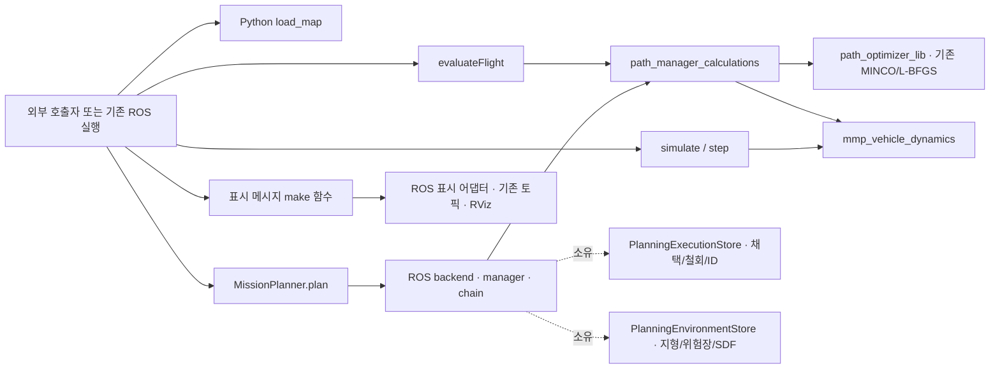

# 기능별 공개 API와 설치 target

이 문서는 현재 호출 방법의 색인이다. 시간순 변경·검증 기록은
[incremental_modularization_ko.md](incremental_modularization_ko.md)에 별도로 남긴다.
ROS 실행, 기존 좌표계·단위·파라미터와 기본 알고리즘을 유지하면서, 입력과 결과를
주고받는 계산과 ROS 실행·발행을 구분한다. 전체 기능을 같은 언어로 옮기거나
ROS 없이 배포하는 독립 SDK를 제공하는 단계는 아니다.

2026-10-13 검토에서 아래 API와 기존 실행의 연결을 확인했다. 검토 중 발견한 병합
재시도의 설정 우선순위 결함은 두 원본 worker의 실제 속도 제한을 사용하도록 수정했다.
상속된 기본값도 같은 규칙으로 보존한다. 회귀 시험과 R2 비교 결과는
[병합 설정 수정 검증](../validation/merge_profile_fix_2026_10_13/README.md)에 있으며,
[수정 전 체크포인트](../validation/modularization_checkpoint_2026_10_13/README.md)는 과거 기록으로 유지한다.

## 기능 선택

| 필요한 기능 | 공개 진입점 | 호출자가 준비할 것 | 반환과 후속 사용 |
|---|---|---|---|
| 지도 준비 | Python `mmp_terrain.map_loader.load_map()` | `MapLoadInput`: 명시적 파일·미션·world·회랑·해상도 설정 | 소유하는 float32 지형, 실제 범위·해상도와 해석한 미션·프레임 |
| 전체 계획 | C++ `MissionPlanner::plan()` | `PlanSettings`, `PlanningEnvironment`, 명시적 backend, `MissionPlanRequest` | 상태·사유, 소유하는 최종/참고 궤적, 평가·단계와 실행 메타데이터 |
| 채택 전 계획 계산 | C++ `RosPlanningBackend::compute()` | 초기화한 backend와 동일한 미션 요청 | 소유하는 `PlanningComputation`; 실행 저장소의 후보 채택은 별도 호환 단계 |
| 지형·위험장 계산 | C++ `TerrainData` 질의와 `terrain_risk::buildMask()/visibility()` | 기존 프레임의 지형, 위험원, 검증된 설정 | 소유하는 horizon mask 또는 높이·가시성·gradient; ROS 발행 없음 |
| 외부 궤적 평가 | C++ `evaluateFlight()` | 궤적, 단계 분할, 환경 조회, 선택 모델, 위험 정책·귀속, 평가 설정 | 소유하는 `FlightEvaluationReport`; 실행 저장소·발행 변경 없음 |
| 추종 시뮬레이션 | C++ `simulate()` / `SimulationSession::step()` | 참조, 초기 상태, 운동 모델, 제어기, 적분 설정 | 소유하는 상태 이력·추종 오차·동역학 집계와 완료/취소 상태 |
| 표시 준비·연결 | C++ `path_manager::visualization`의 `make*()`와 ROS 표시 어댑터 | 표시할 경로·궤적·위험·장애물 데이터와 필요한 조회·설정 | 소유하는 기존 ROS 표시 메시지. 실제 RViz 렌더링 완료를 반환하지 않음 |

지도 로딩 없이 이미 준비한 환경을 계획에 전달할 수 있다. 평가·시뮬레이션·표시는
외부 궤적에도 사용할 수 있으며 전체 계획을 선행해야 하는 강제 파이프라인이 아니다.
표시 API는 기존 ROS 메시지를 사용하고, 표시 준비를 함수 호출로 분리한 경계다.

각 기능은 선택적으로 호출한다. 아래의 화살표는 호출·의존 관계이며 필수 실행 순서가 아니다.



## CMake target의 책임

| 설치된 imported target | 책임 | 남는 의존성 |
|---|---|---|
| `path_manager::path_manager_calculations` | generic planner facade, 실행 값·채택·철회 저장소, 환경 값 검증, 평가·궤적 연결·경로 처리·지형 위험장, 구간 최적화 호출, 전환/종말/경유점 계산 | Eigen, 기존 optimizer·vehicle target. optimizer의 ROS 관련 전이 의존성은 유지 |
| `path_manager::path_manager_lib` | 전체 계획의 현재 ROS backend, PathManager·SegmentChainPlanner 조정, FSM, 환경 저장소와 메시지·시각화 연결 | calculations를 전이 제공하고 기존 ROS·지도·탐색·SDF 연결 유지 |
| `path_optimizer::path_optimizer_lib` | `PolyTrajOptimizer::solve()`와 기존 MINCO·L-BFGS 전체, 설정·비용 프로필 연결 | 기존 ROS·탐색·기체 의존성 유지 |
| `mmp_vehicle_dynamics::mmp_vehicle_dynamics` | 공유 물리, 계획용 `VehicleModel`, 시뮬레이션 엔진·운동 모델·제어기 | 계산 target에는 Eigen. 패키지 자체는 ROS 노드도 빌드 |

계산 target의 목적은 책임과 링크 경계를 정리하는 것이다. 이를 링크한다고
현재 설치 패키지의 모든 ROS 의존성이 없어지는 것은 아니다. 기존
`path_manager::path_manager_lib` 소비자는 target 이름을 바꾸지 않아도 된다.
MINCO·L-BFGS의 내부 알고리즘은 solver 하나의 경계 안에 유지한다.

## 공개 헤더와 사용 문서

| API | 헤더 또는 Python 모듈 | 자세한 문서·예제 |
|---|---|---|
| 계획 | `path_manager/mission_planner.h`, `mission_plan.h`, `plan_settings.h`, `planning_environment.h` | [계획 사용법](planning_library_usage_ko.md), `path_manager/examples/mission_planner_example.cpp` |
| backend 선택·계산 결과 | `mission_planning_backend.h`, `ros_planning_backend.h`, `planning_computation.h` | [계산·채택·평가 계약](planning_computation_usage_ko.md) |
| 지형·위험장 | `path_manager/terrain_data.h`, `terrain_risk.h` | 아래 지형·위험장 계약 |
| 평가 | `path_manager/flight_evaluator.h`, `flight_evaluation.h` | [계산·채택·평가 계약](planning_computation_usage_ko.md), `path_manager/examples/flight_evaluator_example.cpp` |
| 교체 경계 | `path_manager/route_search_backend.h`, `mmp_vehicle_dynamics/vehicle_model.hpp` | [계획 사용법](planning_library_usage_ko.md)의 모델·탐색 주입 규약 |
| 시뮬레이션 | `mmp_vehicle_dynamics/trajectory_simulation.hpp` | [vehicle README](../../../mmp_vehicle_dynamics/README.md), `mmp_vehicle_dynamics/src/trajectory_simulation_example.cpp` |
| 지도 | `mmp_terrain.map_loader`, ROS 직렬화는 `mmp_terrain.ros_terrain` | [지도 API](../../../mmp_terrain/docs/map_loader_api_ko.md), `mmp_terrain/examples/load_map_example.py` |
| 표시 | `path_manager/planning_visualization_data.h`, `ros_planning_visualization.h` | [표시 API 사용법](planning_visualization_usage_ko.md), `path_manager/examples/planning_visualization_example.cpp` |

내부 조정 클래스의 기존 설치 헤더는 호환성을 위해 남는다. 새 외부 사용자는
PathManager·SegmentChainPlanner·ReplanFSM 내부 필드나 실행 저장소를 조작하지 않고
위 진입점을 사용한다. 채택·철회가 필요한 기존 실행 어댑터만 계산 결과의 호환
채택 인터페이스를 사용한다. 일반 외부 호출자는 `MissionPlanner::plan()`이면 된다.

`planning_execution.h`, `planning_environment_store.h`, `direct_plan_settings.h`는
현재 구현·실행 어댑터를 구성하는 하위 경계다. 이 헤더가 설치된다는 이유로 일반
호출자가 세 객체를 직접 조립해야 하는 것은 아니다. `MissionPlanner`는 PM이나
이 저장소를 반환하지 않으며, ROS 전용 `executionManager()`는 기존 FSM·실행
어댑터 연결에 한정한다.

## 내부 저장소와 실행 어댑터

| 소유자 | 직접 소유하는 상태·책임 | 어댑터에 남는 책임 |
|---|---|---|
| `PlanningExecutionStore` | 현재/참조 궤적 값, 단조 증가 ID, 계산 토큰, `seal()`·`apply()`·`revoke()` | 시각·환경 세대 전달, ABORT 메시지 발행과 FSM 복구 |
| `PlanningEnvironmentStore` | 지형·SDF·위험장·장애물·지연 설치 입력, 갱신 세대와 환경 질의 | ROS 설정 해석, solver 연결, 갱신 후 궤적 재검증·표시 순서 |
| 호출별 direct-plan 문맥 | 해당 계산의 optimizer·설정, clearance를 포함한 위험장 조회 입력 | 동일 manager의 호출·환경 갱신 직렬화, 기존 경로·평가 정책 |

PM의 공개 가변 `traj_`는 제거했다. `executionTrajectory()`와
`referenceTrajectory()`는 실행 어댑터용 const 대여 뷰이며, 다음 실행 변경이나
PM 소멸 이후 보관해 사용할 결과가 아니다. swarm 입력도 private 벡터로 분리하여
유휴 상태에서 `replaceSwarmTrajectories()`로 교체하고 const 뷰로만 읽는다.
환경 저장소 역시 private이며 지형·SDF·위험원·장애물 읽기는 const 조회로 제공한다.
환경 저장소의 GridMap 입력 등 기존 ROS 의존성은 아직 유지한다.

환경 변경으로 실행을 철회할 때 저장소는 궤적 ID·기체 ID·환경 세대·사유·위치·시각을
`ExecutionRevocation` 값으로 캡처한다. FSM이 이를 받아 ABORT를 발행하고 대기 중
결과를 폐기한 **뒤** 저장소가 활성 슬롯과 계산 토큰을 무효화하는 기존 순서를 유지한다.
실패한 중간 계산이 소비한 ID와 진단 궤적의 기존 의미도 채택 경계에서 보존한다.
관찰자는 저장소를 재진입하여 변경하지 않는다. 관찰자 예외 시에는 기존 동기 훅과
같이 무효화 전 상태가 남으므로 정상 철회 완료로 간주하면 안 된다.

## 단위와 시간

- 계획 입력·출력 궤적은 기존 계획 좌표 단위 `u`이다. 속도는 `u/s`, 가속도는
  `u/s²`이며 설정의 XY/Z 배율로 SI에 대응한다. 미션 waypoint z는 기존 AGL이다.
  `MissionPlanRequest.start_altitude`가 시작 위치의 절대고도/명령 AGL 해석을 정한다.
- 평가 대상 궤적 z는 전역고도이다. `FlightPhaseMetrics.min_agl` 등 지형 차이는
  계획 단위이고, `min_agl_t` 등 궤적 시각은 참조 시작에서 경과한 초이다.
  모델에 전달하는 PVA만 설정 배율을 적용해 SI로 변환한다.
- `PhaseSpan.t_end`는 각 단계의 누적 종료 시각(초)이다. 구간 길이 목록이 아니다.
  마지막 단계는 전체 궤적 끝에 일치해야 한다.
- 시뮬레이션의 `PolynomialReference`는 기존 PolyTraj의 float 계수와 구간 시간을
  소유한다. 샘플링 후 상태·참조 PVA는 m, m/s, m/s²이고 각도는 rad이다.
  시뮬레이션 `time_s`는 참조 시작에서 경과한 초이다.
- `MissionPlanResult.start_time`과 `reference_start_time`은 기존 ROS 계획 생성
  시점의 절대 시각 메타데이터이다. 궤적 내부 상대 시간이나 새 실행 명령이 아니다.
- Python 지형 결과는 기존 100 m 프레임 단위의 float32이며 `resolution_m`은 m이다.
  미션 원본 z는 m AGL이다. 지형 배열의 행·열/NaN 규칙은 지도 API 문서를 따른다.

C++ double 궤적과 ROS float32 계수는 서로 다른 표현이다. 외부 계획 결과를 기존
follower와 비교하려면 같은 float32 직렬화 입력으로 시뮬레이션해야 한다. 표시나
시뮬레이션 연결에서 임의로 단위·다항식 계수 표현을 바꾸지 않는다.

## 소유권과 호출 순서

`MissionPlanResult`와 `PlanningComputation`의 궤적은 계수·시간을 소유한다. 다음 계획,
내부 임시 optimizer 파괴 또는 환경 갱신이 이미 반환한 계수를 바꾸지 않는다.
`reference_trajectory`는 기존 의미를 유지한다: direct는 MINCO seed, baseline chain은
최적화된 baseline, route chain은 완성된 비행 궤적이다.

평가 입력의 궤적·단계·구간 귀속 포인터와 환경 조회는 한 동기 호출 동안 빌려 쓴다.
조회 제공자와 값은 반환까지 유효하고 안정적이어야 하며 결과에는 보관하지 않는다.
표시 준비 조회도 동기 호출의 수명 규약을 따른다. `VehicleModel`을 병렬 구간 worker가
공유하므로 const 질의는 동시 읽기를 지원해야 한다.

동일 planner의 계획·환경·모델·탐색·설정 변경은 직렬로 수행한다. 계산과 채택 사이에
새 계산, 환경·실행 갱신, 모델·탐색 교체가 일어나면 이전 결과의 채택 토큰이 거부된다.
토큰은 환경 불변 snapshot이 아니다. live ROS 파라미터 변경은 토큰으로 추적하지
않으므로 계산과 채택 사이에 변경하면 안 된다. `compute()`는 새 후보를 실행 저장소에
채택하지 않지만 기존 환경 준비·재검증까지 부작용 없는 함수라는 뜻은 아니다.

시뮬레이션 세션은 입력 참조·설정·이력을 소유하고 모델·제어기를 shared const 객체로
유지한다. 기본 전략은 생성 시 설정을 복사한다. RK4 중간 상태와 재생에서 반복 호출될
수 있으므로 전략은 숨은 상태를 호출 횟수로 전진시키지 않는다. 상태를 가진 새 제어기나
다른 상태 표현의 VTOL/6DOF 엔진은 이번 인터페이스의 보장 범위가 아니다.

`SimulationSession::states()`는 세션이 빌려주는 참조다. 상태 원소 참조를 다음
`step()`의 벡터 변경을 넘어 보관하지 않는다. `std::move(session).takeResult()`는
부분/완료 이력을 소유 결과로 옮긴다. 이후 세션을 재사용하지 않는다.

지도 배열은 호출 결과가 소유하며 열린 raster handle을 보관하지 않는다. 호출자가
이미 해석한 `mission_snapshot`을 넘기면 그 snapshot은 명시적으로 재사용하므로 호출
중 수정하지 않는다. 미션·자산이 다른 요청의 snapshot을 넘겨서는 안 된다.

표시 준비 함수는 입력 참조와 조회 콜백을 저장하지 않고 소유하는 ROS 메시지를 반환한다.
호출 동안 제공자를 유효하고 안정적으로 유지해야 한다. 잘못된 구조는
`std::invalid_argument`, 제공자의 예외는 그대로 전파하며 부분 메시지를 반환하지 않는다.
빈 궤적의 clear/no-tube 동작은 기존 의미를 따른다. `RiskSettings`는 기존 설정의
명시적인 투영이며 0으로 초기화한 값을 사용 가능한 기본 프로필로 간주하지 않는다.

`PlanSettings.attach_visualization=false`는 manager의 `/viz/*`, `/debug/pipeline`,
`/planning/front_end_path` 표시 준비·발행을 끈다. 전체 ROS, terrain/SDF, 실행/철회
동작을 끄는 옵션은 아니다. 표시 연결을 생략해도 계획 계산은 같은 구현을 사용한다.

## 지형·위험장과 worker 설정

`terrain_risk::buildMask(zone, terrain, settings)`는 하나의 위험원에 대한 horizon
mask를 값으로 반환한다. 입력 지형은 빌려 쓰며 복사하지 않는다. 재구축할 때
`buildMask(zone, terrain, settings, std::move(previous_mask))`로 기존 sample buffer
용량을 재사용할 수 있다. 이동한 이전 mask는 반환값으로 교체한 뒤 사용한다.

`shadowCeiling()`, `groundedZ()`, `visibilityValue()`, `visibility()`는 같은 지형·mask와
명시적 설정을 사용한다. 높이·길이는 기존 계획 프레임이며 별도 SI 변환을 수행하지
않는다. `Settings`는 ROS 설정의 투영으로 기본값 저장소가 아니다. 호출자는 기존과
동일하게 유효한 지형 geometry, 유한한 질의 좌표, 양의 finite softness, builder가
만든 변경하지 않은 mask를 제공한다. disabled/invalid/null mask는 기존 ideal
visibility 규칙을 따른다. malformed mask를 검증하는 새 정책을 추가한 API는 아니다.

`TerrainData`의 셀 중심·행/열·NaN·water·gradient·thread-local memo 규칙은 그대로다.
샘플 배열을 같은 객체에서 교체하는 호출자는 `generation`을 증가시킨다. PM을 통한
환경 설치에서는 `PlanningEnvironmentStore`가 기존 갱신 규칙을 수행한다.
질의와 동시에 지형·mask를 변경하지 않는다.

하위 API `PathManager::makeConfiguredOptimizer(overrides)`는 route worker가 달리
사용할 수 있는 `optimization/weight_time`, `optimization/weight_Risk`,
`optimization/max_vel`, `optimization/risk_parallel_threads`만 허용한다. 다른 키는
설정 전에 `std::invalid_argument`로 거부한다. route mode의 phase/segment 프로필은 기존 세 키만
허용하며 thread budget은 조정기가 정한다. 각 설정의 타입·정규화·기본값은 기존 reader와
solver가 결정한다. override 값을 적용하기 위해 공유 ROS 파라미터를 바꾸지 않는다.
최초 기본 파라미터 선언은 기존 ROS 초기화 책임이므로 선언 콜백까지 없다는 뜻은 아니다.
worker 생성과 환경 변경은 직렬로 하고, 환경과 manager는 모든 worker solve보다 오래 산다.
worker는 생성 시 위험원 geometry·DEM sampling pitch·설정·기체 모델 연결을 보관하지만
조회 콜백은 live manager를 사용한다. 모든 worker solve가 끝난 뒤 환경·모델·공유 설정을
변경하고, 다음 solve 전에 `makeConfiguredOptimizer()`로 worker를 다시 만든다.

독립 optimizer의 `PolyTrajOptimizer::setParam(node, overrides)`는 기존 전체 optimizer
설정 reader에 호출별 값만 우선한다. 읽은 수치를 저장하므로 override vector는 반환 후
파괴할 수 있다. node와 환경 lifetime은 기존 solver 규약을 따른다. MINCO·L-BFGS 본체는
`solve()` 안에 유지된다.

순차 baseline 구간과 single-shot fallback의 프로필은 하위
`computeGlobalTrajectory(DirectPlanSettings, ...)`가 호출별 optimizer와 설정으로
처리한다. clearance는 FE·코너 검사·위험장·표시까지 해당 호출의 값으로 전달하며
미션 optimizer·설정과 전체 비행 평가의 문맥은 유지한다. 공유 ROS 파라미터를
임시로 덮어쓰거나 optimizer를 원복하는 방식은 제거했다. 이 경계는 기존 전체
프로필을 처리하는 직렬 어댑터 입력이며, 위 네 키만 허용하는 병렬 worker API와
별개다. 독립 환경 snapshot이나 동일 PM에 대한 동시 호출을 허용하지 않는다.

## 실패·예외·부분 결과

| 기능 | 호출자가 확인할 것 |
|---|---|
| 계획 | `result.hasTrajectory()`와 `status`. 실패한 `MissionPlanResult`는 사용할 최종 궤적을 제공하지 않는다. DEGRADED의 사유를 보존한다. |
| 채택 전 계산 | 반드시 `hasTrajectory()` 확인. 실패 결과의 `product`가 남아 있을 수 있으나, 이는 거부된 중간 결과의 기존 저장소 무효화 재현용이며 실행용 결과가 아니다. |
| 평가 | 먼저 `report.issue == NONE`와 `verdict.evaluated`를 확인한 다음 `clean`·`unflyable()`를 해석한다. 미평가 기본값도 기존대로 `clean=true`이므로 이것만으로 성공을 판정하지 않는다. 잘못된 계수·시간·설정·단계는 미평가이며, 없는 위험 정책을 측정한 정책으로 간주하지 않는다. |
| 시뮬레이션 | 완료는 `COMPLETED`, 명시적 취소는 `CANCELLED`와 부분 이력. `step()`은 상태를 추가하면 true, 종료 확인 후 false. false까지 호출해야 완료를 확인한다. |
| 지도 | 파일·해석·예산 실패는 예외. 기존 게시 지형 유지/rollback은 ROS 서비스 어댑터 책임이다. `world="none"`은 명시적 삭제 결과다. |
| 표시 | 메시지 준비·발행 성공은 화면 렌더링 완료의 보증이 아니다. 기존 토픽의 삭제·갱신 순서와 시간 의미를 어댑터가 유지한다. |

초기 설정 오류와 동기 콜백·모델의 예외는 기존대로 호출자에게 전파된다. 모든 예외를
계획 실패 결과로 변환하지 않는다. 병렬 구간 worker 안에서 처리하지 않은 예외는
현재 프로세스를 종료할 수 있다. worker 종료·결과 채택 정책을 바꾸려면 별도 변경과
검증이 필요하다.

시뮬레이션은 잘못된 입력에 `std::invalid_argument`를 던진다. 전략 예외가 발생한
`step()`에는 추가한 상태와 일부 지표가 남을 수 있으므로 해당 세션을 폐기한다.
롤백·예외 뒤 재개는 보장하지 않는다. 직접 `PolynomialReference::sample()`을
호출할 때는 마지막 필드 변경 후 `validate()`를 먼저 실행한다.

직접 계획은 기존 optimizer audit만 유지하여 결과의 whole-flight
`evaluation.evaluated`가 false이다. chain과 같은 평가를 자동으로 추가하지 않는다.
외부 호출자는 필요한 궤적에 `evaluateFlight()`를 별도로 호출할 수 있다. 이 평가는
기존 0.1 s 표본 판정을 보존하며 연속 충돌 검사나 비행 안전 보증이 아니다.

## 설치된 API 검증 예제

`path_manager`는 `share/path_manager/examples/library_consumer`에 외부 CMake
프로젝트와 계획·평가 예제 소스를 설치한다. 시뮬레이션 예제 소스는
`share/mmp_vehicle_dynamics/examples`에 설치한다. 해당 consumer는 설치된 imported
대상만 연결하고 저장소 include 경로나 MMP 구현 소스를 직접 컴파일하지 않는다.

```bash
source /opt/ros/humble/setup.bash
source /ws/install/setup.bash
cmake -S /ws/install/path_manager/share/path_manager/examples/library_consumer \
  -B /tmp/mmp_api_consumer_build -DCMAKE_BUILD_TYPE=Release
cmake --build /tmp/mmp_api_consumer_build -j2
/tmp/mmp_api_consumer_build/flight_evaluator_client
/tmp/mmp_api_consumer_build/trajectory_simulation_client
/tmp/mmp_api_consumer_build/planning_visualization_client
/tmp/mmp_api_consumer_build/mission_planner_client \
  /ws/install/path_manager/share/path_manager/config/optimizer_params.yaml
```

지도 예제는 설치된 Python 모듈과 명시적인 지도·미션 자산을 사용한다. 실행 인자는
`share/mmp_terrain/examples/load_map_example.py --help`와 지도 API 문서를 따른다.
예제의 synthetic 입력 검증, 실제 R2 수치 회귀, ROS/RViz 실행 검증은 서로 다른
검증 범위이며 실행한 결과는 검증 기록에서 구분한다.
