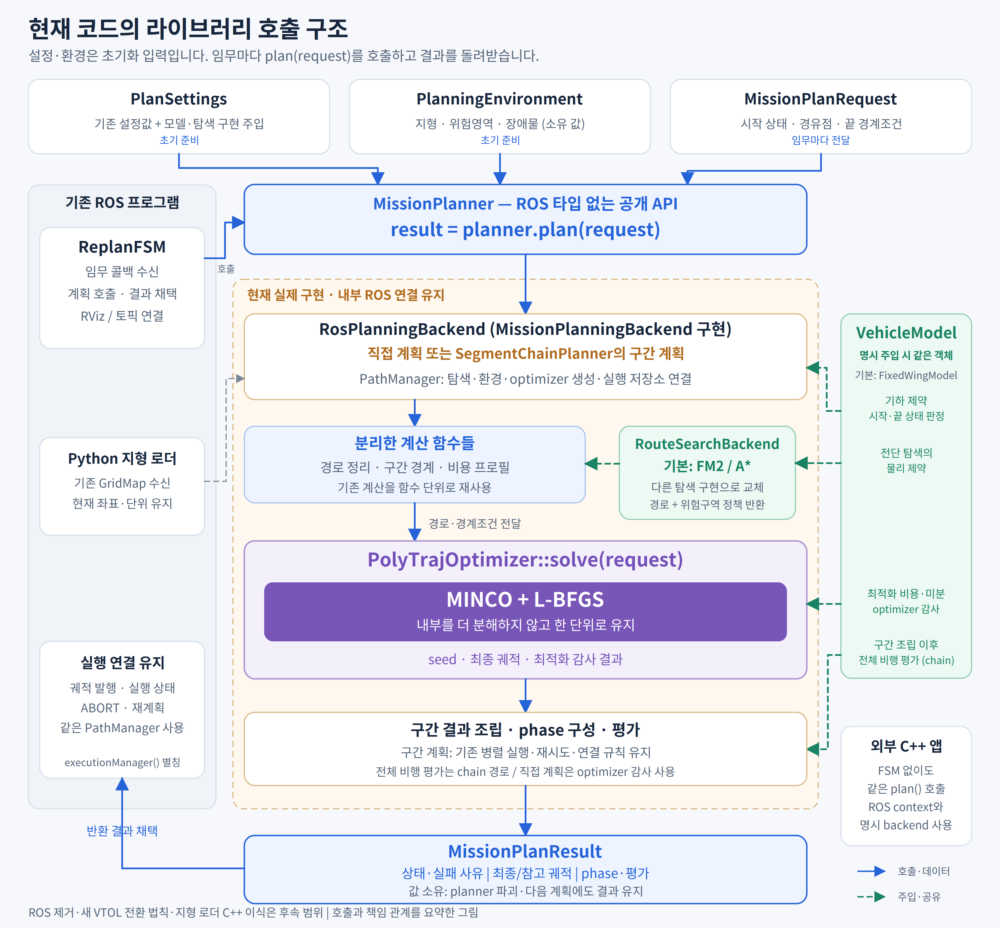

# 계획 라이브러리 사용법

전체 임무는 `path_manager::MissionPlanner::plan(request)`로 계산한다. 설정과 환경,
계산 backend를 초기화하면 호출자는 경로 탐색·구간 분할·병렬 최적화·재시도·궤적 연결을
직접 조정할 필요 없이 상태와 소유하는 궤적을 받는다. 이미 준비한 경로의 최적화만
필요하면 `ego_planner::PolyTrajOptimizer::solve(request)`를 사용한다.

현재 실제 구현은 **ROS 2 Humble을 사용하는 `RosPlanningBackend`**다. 일반 입력과
`MissionPlanner` 헤더·구현에는 ROS 타입이 없지만, 설치된 계산 라이브러리는 여전히
ROS를 필요로 한다. 기존 `ReplanFSM`도 같은 계획 API를 사용하며 콜백·토픽 발행·실행
상태·ABORT·재계획은 ROS 실행 계층에 남는다. `plan()`은 동기 계산 호출이고, 반환된
궤적을 실제로 실행하는 명령은 별도다.

이 문서는 현재 API를 기준으로 한다. 변경 과정과 과거 API는
[단계별 구현 기록](incremental_modularization_ko.md), 수치 회귀와 재현 정보는
[보존된 검증 자료](../validation/planning_library_2026_10_08/README.md)를 참고한다.

## 실행 가능한 예제

[mission_planner_example.cpp](../../src/path_manager/examples/mission_planner_example.cpp)는
ROS context 초기화부터 지형·미션 작성, 계획, 결과 샘플링, 종료까지 포함한 완전한 예제다.
기존 YAML과 평탄한 소유 지형을 사용하며 FSM, RViz, 미션 토픽 또는 executor 없이
계획을 호출한다. 이 예제는 실제 R2 지형 임무와 별개의 사용 예제다.

빌드된 `mmp_dev` 컨테이너에서 다음과 같이 실행한다.

```bash
docker exec -it -u user mmp_dev bash
source /opt/ros/humble/setup.bash
source /ws/install/setup.bash
ros2 run path_manager mission_planner_example \
  "$(ros2 pkg prefix path_manager)/share/path_manager/config/optimizer_params.yaml"
```

외부 CMake 프로젝트에서는 위 예제 소스를 `mission_planner_example.cpp`로 두고 다음과
같이 연결할 수 있다. ROS와 MMP 설치 환경을 source한 상태에서 configure/build한다.
공개 target은 필요한 의존성과 C++17 요구를 전파한다.

```cmake
cmake_minimum_required(VERSION 3.16)
project(mmp_planning_client LANGUAGES CXX)

find_package(path_manager REQUIRED)
add_executable(mmp_planning_client mission_planner_example.cpp)
target_link_libraries(mmp_planning_client PRIVATE path_manager::path_manager_lib)
```

## Planner 생성과 설정

현재 생성자는 다음과 같다.

```cpp
MissionPlanner(PlanSettings settings,
               PlanningEnvironment environment,
               std::unique_ptr<MissionPlanningBackend> backend);
```

`MissionPlanner`는 backend를 소유하고 생성 중 한 번 초기화한다. 별도의 live 설정
사본을 유지하지 않는다. backend는 초기화를 재시도하거나 두 번 초기화할 수 없다.
잘못된 초기 지형·모델·설정 연결 등은 예외로 거부하므로 초기화 예외와 계획 실패 결과를
구분해서 처리한다.

ROS backend에는 두 생성 방식이 있다.

| 방식 | 사용법 | 설정 기준 |
|---|---|---|
| backend가 node 생성 | `makeRosPlanningBackend(RosPlanningOptions)` | `PlanSettings.parameters`의 명시 값이 `NodeOptions`와 YAML override보다 우선 |
| 기존 node 연결 | `makeRosPlanningBackend(node)` | 기존 node가 설정 기준. `PlanSettings.parameters`는 비워야 하며 모델·탐색 주입은 허용 |

어느 방식이든 호출자가 ROS context를 초기화하고 종료한다. backend는
`rclcpp::init()`이나 `rclcpp::shutdown()`을 호출하지 않는다. 사용 중인 planner와
관련 ROS 객체를 파괴한 뒤 context를 종료한다. 값 입력 방식에서는
`automatically_declare_parameters_from_overrides`를 기본값 `false`로 유지해야 한다.
기존 소비자의 파라미터 선언 순서와 타입을 보존하기 위한 조건이다.

`PlanSettings.parameters`는 기존 이름을 사용하는 **희소 초기 override**다. 모든 수치
설정을 새 기본값 테이블로 복제하지 않는다. 사용 가능한 값 타입은 `bool`, `int64_t`,
`double`, `std::string`과 byte/bool/int64/double/string 벡터다. 기존 소비자가 선언하는
타입과 일치시킨다. 예를 들어 다음은 정수 구간 수와 실수 설정을 구분한다.

```cpp
path_manager::PlanSettings settings;
settings.parameters["chain/enable"] = true;
settings.parameters["chain/segments"] = int64_t{5};
settings.parameters["manager/obstacle_clearance"] = 0.6;
```

YAML을 쓰려면 `RosPlanningOptions::node_options.arguments()`에
`{"--ros-args", "--params-file", config_path}`를 전달한다. 기존 node 방식에서
초기 설정을 바꾸려면 node 생성·설정 단계에서 적용한다. 설정의 적용 시점은 기존
소비자별 의미를 유지하며, 모든 ROS 파라미터가 실행 중 즉시 갱신된다는 뜻은 아니다.

ROS 실행 연결에서 manager가 필요하면 생성한 `RosPlanningBackend`의
`executionManager()`를 초기화 후 사용한다. 이것은 별도의 planner가 아니라 backend가
사용하는 동일 `PathManager`의 공유 참조다. 일반 라이브러리 호출에는 필요하지 않다.
과거 `MissionPlanner(node)`와 `legacyManager()` 대신 이 명시적 연결을 사용한다.

## 미션 입력과 좌표

[MissionPlanRequest](../../src/path_manager/include/path_manager/mission_plan.h)는
이미 해석한 시작 상태, 경유점, 끝 경계조건과 편대 정보를 받는다. 미션 YAML을 직접
파싱하는 API는 아니다. 기존 Python loader·panel·FSM의 미션 해석은 그대로 유지한다.

현재 배포 설정의 planner 좌표는 `1 u = 100 m`, `+x = 북쪽`, `+y = 서쪽`,
`+z = 위쪽`이다. 위치는 u, 속도는 u/s, 가속도는 u/s², 시간은 초다.
공개 계획 API에서 SI 변환이나 축 변경을 자동 수행하지 않는다.

| 입력 | 의미 |
|---|---|
| `head` | `StartHead`의 위치·속도·가속도와 상태 출처. 기본 `UNSPECIFIED`는 거부 |
| `head.acc_prescribed` | 시작 가속도를 명시했는지. 영벡터를 명시한 경우도 `true` |
| `start_altitude = ABSOLUTE` | 시작 `head.pos_u.z()`를 절대 고도로 전달 |
| `start_altitude = COMMAND_AGL` | 시작 z를 현재 지형과 기존 최소 AGL 규칙으로 한 번 변환. 지형이 없으면 기존 동작대로 절대 고도로 유지 |
| `waypoints` | x·y는 planner 좌표, z는 기존 미션 AGL 규약. 지형이 있을 때 최소 AGL과 지형 높이를 적용 |
| `tail` | `TailBoundary`의 속도·가속도 지정 플래그와 값. 미지정은 기존 도착 규칙 사용 |
| `length_per_piece`, `obstacle_clearance` | 양수면 기존 manager 설정에 적용하고 이후 호출에도 유지. 0 이하이면 이전 설정 유지 |

`start_altitude`는 시작점에만 적용된다. `ABSOLUTE`를 선택했다고 경유점의 z도 절대
고도로 바뀌지는 않는다. 지형이 없는 경우 경유점도 기존 고도 해석을 유지한다.
반면 optimizer 단독 요청과 준비된 경로 계산은 이미 해석된 **절대 planner 좌표**를 받는다.

`StartHead`에는 해석된 속도 벡터를 넣는다. 스칼라 속도 명령만 가진 경우에는 기존
호출자처럼 벡터를 먼저 구성하고 `STATED_SPEED` 출처를 붙인다. `STATED_VECTOR`는
방향까지 명시한 명령이다. 출처는 경로 방향 정렬·속도 보정 허용 여부에 영향을 주므로
거부를 피하기 위해 임의로 `TRAJECTORY_DERIVED` 등으로 바꾸지 않는다.

## 환경 전달과 갱신

[PlanningEnvironment](../../src/path_manager/include/path_manager/planning_environment.h)는
초기 환경에 적용하는 값 묶음이다. `terrain`, `risk_zones`, `dynamic_obstacles`는
각각 optional이며 다음 의미를 가진다.

| 값 | 적용 |
|---|---|
| 필드 미지정 | 해당 setter를 호출하지 않고 기존 설정 유지 |
| 지형 지정 | 표현을 검증한 뒤 지형 교체 |
| 빈 위험영역 목록 지정 | 기존 위험영역 clear 의미대로 삭제 |
| 빈 동적 장애물 목록 지정 | 기존 동적 장애물 clear 의미대로 삭제 |
| 비어 있지 않은 장애물 목록 지정 | 기존 동적 장애물을 지운 뒤 입력 순서대로 추가 |

초기 적용 순서는 지형 → 위험영역 → 동적 장애물이다. 지형 삭제는 optional 미지정으로
표현하지 않고 `clearTerrain()`을 호출한다. 이후에는 `setTerrain`, `setRiskZones`,
`addDynamicSphere`, `addDynamicBox`, `clearDynamicObstacles`로 갱신한다.

`setTerrain(grid, &error)`가 `false`이면 이전 지형은 유지된다. `setRiskZones()`도
갱신 수락 여부를 반환한다. 장애물 추가의 반환값은 `>= 0`이면 추가 ID, `-2`이면
첫 거리장 구성까지 정상 대기, `-1`이면 거부다. `-2`를 무조건 실패로 처리하지 않는다.

`TerrainGrid`는 중심, 길이, 해상도, 행·열 수와 `std::vector<float>`를 소유한다.
row는 X, col은 Y에 대응하며 데이터 인덱스는 `elevation[col * rows + row]`다.
원래 배열과 NaN, 여분 payload를 보존하고 경계에서 전치·회전·재샘플링·단위 변환을
하지 않는다. 실제 방향 반영과 샘플링은 기존 지형 구현이 담당한다. ROS `GridMap`
연결은 [ros_terrain_grid.h](../../src/path_manager/include/path_manager/ros_terrain_grid.h)에 있다.

이 입력이 값을 소유한다는 사실은 계산 중 환경이 불변 snapshot이라는 뜻이 아니다.
같은 planner의 계획 호출과 환경·설정 변경은 직렬로 사용한다. 실행 중 ROS 환경
갱신은 기존 실행 계층의 재검증·궤적 철회 정책을 따른다.

## 결과 처리와 소유권

`MissionPlanResult::hasTrajectory()`를 먼저 확인한다. 상태의 의미는 다음과 같다.

| 상태 | 처리 |
|---|---|
| `SUCCESS` | 기존 정책의 요구를 만족한 궤적 |
| `DEGRADED` | 기존 허용 정책에 따른 완화나 fallback이 적용된 궤적. `reason`과 `detail` 확인 |
| `FAILED` | 실행 가능한 궤적 없음. 이전 성공 결과를 새 결과로 반환하지 않음 |

`hasTrajectory()`는 `DEGRADED`에도 참이다. 호출자가 완화 사유까지 구분해야 하는
경우 `status.outcome`, `status.reason`, `status.detail`을 함께 확인한다.

최종 `trajectory`와 `reference_trajectory`는 계수와 구간 시간을 값으로 소유한다.
다음 계획, 환경 갱신, planner 파괴가 이미 반환된 데이터를 바꾸지 않는다.
`getPos(t)`, `getVel(t)`, `getAcc(t)`의 `t`는 궤적 시작부터의 초이며
`0 <= t <= getTotalDuration()` 범위에서 사용한다.

참고 궤적의 의미는 기존 저장소와 같다. 직접 계획에서는 MINCO seed, baseline chain에서는
최적화 baseline, route chain에서는 전체 비행이다. 모든 모드에서 같은 종류의 초기
경로라고 해석하지 않는다.

`evaluation`, `phases`는 계산 모드에 따른 결과다. chain에는 전체 비행 평가가 있고,
chain을 끈 직접 계획은 optimizer의 기존 검사만 수행하므로
`evaluation.evaluated == false`다. 이 값을 확인하지 않고 기본 평가값을 성공 판정으로
사용하지 않는다. `trajectory_id`, 시각, `environment_generation`도 함께 반환한다.
환경 번호는 결과를 포장할 때 관찰한 revision이며 이후 환경에서도 실행 가능하다는
보증은 아니다. 실행 유효성은 ROS 실행 계층 또는 외부 호출자가 관리한다.

## 기체 모델과 탐색 구현 교체

초기에는 `PlanSettings::vehicle_model`, `route_search_backend`로 주입하고, 미션 사이
유휴 상태에서는 `setVehicleModel()`과 `setRouteSearchBackend()`로 교체한다.
같은 인스턴스에 대한 교체와 계산은 동시에 실행하지 않는다.

`VehicleModel::Ptr`는 `shared_ptr<const VehicleModel>`이다. 명시 주입한 동일 모델을
탐색의 물리 제약, 독립 구간 optimizer, 최종 평가에 공유한다. 구현체의 const 메서드는
병렬 호출에 안전해야 하며 물리 질의의 입력·미분은 SI 단위다. 기본 `FixedWingModel`은
기존 동역학 함수를 호출한다. null로 교체하면 ROS 설정의 기본 모델로 복귀한다.
잘못된 모델 또는 유효하지 않은 기본 모델로의 복귀는 예외로 거부하며 기존 연결을 유지한다.

이 인터페이스는 follower나 새 VTOL 전환 법칙을 제공하지 않는다. 현재 PVA 표현으로
다룰 수 없는 상태나 새 전환 제어법은 추가 설계가 필요하다. 기존 고정익 전환 생성기는
`fixedWingTransitionParameters()` 능력을 명시한 모델에만 적용한다.

`RouteSearchBackend::search(const RouteSearchProblem&)`는 한 leg의 경로를 동기로
계산한다. 기본 FM2/A* 선택과 각 알고리즘 전용 파라미터는 구현체에 있고, 공통 입력은
시작·목표·물리 제약·환경 조회·모델·호출 식별 정보를 담는다. 결과는 소유 경로와 상태,
상세 사유, 제공 가능한 위험영역 정책을 반환한다.

외부 탐색 구현은 알 수 없는 정책을 `UNKNOWN`으로 남긴다. MMP의 canonical 정책을
제공할 때는 입력 identity와 위험영역 순서를 보존하고 실제 계산한 판정만 반환한다.
기본 FM2의 3-pass를 실행하지 않았다면 그 pass 번호를 만들어 넣지 않는다. 호출자는
경로와 정책의 구조·identity를 검사하고 기존 미측정 정책 규칙을 적용한다.

탐색 입력의 거리장과 callback 제공자는 한 동기 호출 동안 빌린다. 구현체는 입력
참조나 제공자를 반환 후 사용하면 안 된다. callback 객체를 복사해도 raw pointer나
참조로 캡처한 제공자의 수명이 연장되지는 않는다. 구현체별 세부 계약은
[route_search_backend.h](../../src/path_manager/include/path_manager/route_search_backend.h)에 있다.

## 최적화만 호출하기

이미 경로와 경계조건이 준비되어 있으면 전체 미션 API 대신
`PolyTrajOptimizer::solve(OptimizerSolveRequest)`를 사용한다. 설치된 optimizer
target만 링크하며 `path_manager` 링크는 필요하지 않다.

```cmake
find_package(path_optimizer REQUIRED)
target_link_libraries(my_optimizer PRIVATE path_optimizer::path_optimizer_lib)
```

설정 순서는 `setParam(node)`로 기존 수치 설정을 읽고,
`setRuntimeSettings(settings)`로 선택한 실행 설정을 적용하고,
`setEnvironment(environment)`로 거리장·지형·위험 조회를 연결하는 것이다.
필요하면 `setVehicleModel(model)`도 명시한다. 실행 설정 묶음의 기본값을 적용하는
것과 현재 manager 설정을 재현하는 것은 다르므로 기존 결과를 재현할 때는 같은 값을
전달해야 한다. `setParam()`과 로깅 연결은 여전히 ROS adapter를 사용한다.

[OptimizerSolveRequest](../../src/path_optimizer/include/path_optimizer/optimizer_request.h)는
절대 planner 좌표의 경로·경유점, head PVA, tail, 고도 대역, cap·leg 정보와
`max_vel`을 소유한다. 여기의 `max_vel`은 seed와 도착 속도 계산용 값이며 YAML의
`optimization/max_vel`과 별개다. 유한한 양수로 지정한다.

성공 결과는 seed·최종 궤적·envelope 측정값을 소유한다. 실패 상태는 짧은 경로,
경유점 없음, 미설정, 잘못된 입력, optimizer 실패를 구분한다. 기존 bool 실패를
비수렴·충돌 등으로 추측해 세분화하지 않는다. 실패 시 이전 궤적이나 부분 seed를
노출하지 않고 진단 경로는 반환할 수 있다.

`OptimizerEnvironment`의 거리장과 callback이 캡처한 제공자는 바인딩된 동안 살아
있어야 하고 각 solve의 병렬 비용 평가 동안 안정적이어야 한다. 환경 교체와 solve는
직렬로 실행한다. 위험영역을 바꿀 때는 순서가 맞는 기하와 제공자를 함께 갱신한다.
빈 환경 필드는 이전 연결을 해제한다. 결과 궤적의 소유권은 이 제공자 수명과 별개다.

MINCO·L-BFGS는 `solve()` 안의 기존 최적화 본체로 유지한다. 이번 경계는 입력·비용
프로필·모델·환경과 결과를 정리하며 최적화 알고리즘 내부를 새 solver들로 분해하지 않는다.

## 현재 구조와 적용 범위



[기존과 현재 비교 그림](figures/modularization_overview_ko.png)도 함께 볼 수 있다.
모델·탐색은 주입 관계이며 순차 처리 단계가 아니다.

기존 병렬 구간 계획, 3-pass, ROS/RViz 실행, Python 지형 로더, follower와 단위 규약을
유지한다. `PathManager`에는 환경·실행 저장소·시각화 연결이, `SegmentChainPlanner`에는
조정·평가 책임이 남아 있다. 전체 ROS 제거, 지형 로더 C++ 이식, 독립 simulator와
visualizer, 공개 SI 규약 전환, 범용 VTOL 지원은 현재 API의 제공 범위에 포함하지 않는다.
