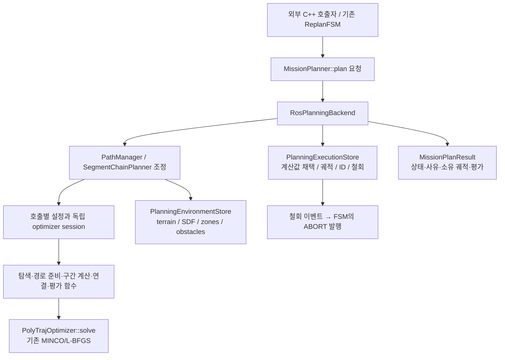

# 잔여 모듈화 경계 정리 — 2026-10-11

이번 범위는 사용자와 합의한 세 항목이다: 호출별 baseline/fallback 설정, 환경/실행
소유권 분리, 공개 API와 내부 접근 범위 정리. 상위 `lgh/dev`의 `a297f234`, 계획
서브모듈 `mmp_dev`의 `d2ef5496`에 직전 최종 검토의 미커밋 수정이 더해진 상태를
변경 전 기준으로 삼았다. 해당 설치물은 별도 prefix에 보존하고 비교했다.

## 완료 기준과 구현

| 완료 기준 | 최종 구조 | 확인 방법 |
|---|---|---|
| baseline/fallback이 공유 설정을 변경·복구하지 않음 | `DirectPlanSettings` → 독립 optimizer + `DirectSolveContext`; segment last-wins와 hard-limit min 정책 유지 | 모든 기존 optimization 키의 갱신 감시, 다음 요청 동일성, 실제 FPA/model/visibility 전달 |
| 환경과 실행이 각자의 인터페이스로 연결됨 | private `PlanningEnvironmentStore`와 `PlanningExecutionStore`; PM은 호출 순서와 재검사를 조정 | 환경/SDF 원본 수치, 채택/철회 계약, 실제 ABORT·복구 |
| 외부가 공개 API만 사용함 | `MissionPlanner::plan()` 유지; 가변 `traj_` 제거, const 실행/참고/swarm 뷰와 명시적 변경 함수 | 설치 CMake 예제, 비공개 접근/const 정적 검사, 기존 호출자 빌드 |

외부 사용자는 환경·설정을 초기화한 후 미션마다 기존 `MissionPlanner::plan(request)`를
호출한다. 새 owner나 구간별 내부 함수의 호출 순서를 직접 관리할 필요가 없다.
ROS 실행도 같은 계산 경로를 사용한다. 공개 사용법과 설치 예제는
[현재 API 안내](modularized_function_api_ko.md),
[계획 라이브러리 사용법](planning_library_usage_ko.md)에 있다.

## 호출별 설정

`DirectPlanSettings`는 기존 이름·자료형의 ROS adapter 설정을 값으로 전달한다.
`DirectSolveContext`에는 해당 호출의 optimizer, clearance, altitude weight,
cap/floor headroom, dynamics XY unit, FPA가 담긴다. 준비·탐색·코너 검사·고도 제한·
최적화·표시가 같은 값을 사용한다. 구간 프로필이 하나라도 있으면 설정 없는 구간도
독립 session을 만드는 기존 재초기화 의미를 유지한다. parallel worker의 네 설정
화이트리스트는 그대로다. MINCO/L-BFGS 내부는 변경하지 않았다.

탐색기가 보관하는 visibility callback의 수명도 나눴다. 일반 미션 callback은 명시적
optimizer 재초기화에 따라 갱신되는 미션 설정을 조회한다. 임시 호출 callback은
clearance를 값으로 캡처하고, 종료·실패·예외 뒤 미션 callback에 다시 연결한다.
정책 epoch와 구간별 disposition을 초기화하거나 공유 설정을 임시 변경하지 않는다.
최종 전체 비행 평가는 기존 미션 기준을 유지한다.

설정 구성 오류만 `DirectPlanConfigurationError`로 구분한다. 외부 탐색 backend의
예외를 실패 결과로 바꾸는 기존 어댑터 정책과 baseline/fallback 실패 처리도 유지했다.
테스트에서는 최초 기본값 선언과 이미 선언된 ROS 값의 변경을 구분한다. 선언 뒤 같은
키를 바꾸는 동작은 모두 감시한다.

실행 중 임의의 ROS 파라미터 갱신을 일괄 지원하는 새 설정 체계는 만들지 않았다.
직렬로 기본값을 바꾼 뒤 primary optimizer·미션 위험장에 적용하려면 명시적 재초기화가
필요하다. 새 worker와 slice 설정은 현재 기본값을 함께 읽으며 worker 생성이 primary
설정을 몰래 변경하지 않는다. 이 규약은 사용 문서와 재초기화 회귀 검사에 명시했다.

## 환경과 실행

`PlanningEnvironmentStore`는 terrain 복사본·세대, SDF와 grid/bounds latch, 작성/유효
위험구역·mask, 동적 장애물·대기열·yaw RNG를 소유한다. 조회는 const이고 clearance는
호출별 인수다. terrain 수신, SDF 준비, 지연 장애물 설치, 위험장 갱신을 분리해 PM이
기존 순서대로 호출한다. 일반 terrain setter가 자동 ABORT를 새로 발생시키거나,
zone setter가 실행 정책을 대신 판단하도록 바꾸지 않았다.

`PlanningExecutionStore`는 현재/참고 궤적·ID·seal/apply 토큰을 소유한다. 환경 세대와
시각은 인수로 받고 node·clock·publisher를 갖지 않는다. 철회 이벤트는 궤적을
무효화하기 전에 식별 정보와 사유를 값으로 캡처해 FSM에 전달한다. 실패 중간 결과의
ID 소비, 오래된/중복/타 manager 결과 거부, emergency 경로도 유지한다.

swarm 궤적은 자체 실행 결과와 별도 비공개 저장소로 관리한다. optimizer가 빌린
swarm vector의 주소는 교체 함수 호출 후에도 안정적이다. 기존 호출자와 테스트는
가변 필드 쓰기 대신 값 입력·채택 API를 사용한다.

## 검증

최종 실행 결과와 원본 로그는
[검증 기록](../validation/remaining_boundaries_2026_10_11/README.md)에 보존한다.
단계별 기록은 [증분 모듈화 기록](incremental_modularization_ko.md)의
“잔여 경계 정리” 항목에서 볼 수 있다.

## 유지하는 경계

ROS 실행·RViz·Python 지형 로더, 기존 좌표/단위/기본값, 병렬 계획·3-pass와
취소·재계획 흐름을 유지한다. 같은 planner의 환경/설정 변경과 계산·채택은 직렬이다.
계산 중 preview 발행과 환경 준비 효과가 있으므로 완전한 무부작용 함수로 설명하지 않는다.

PM과 chain은 어댑터·조정자로 남고 필요한 내부 헤더도 기존 패키지 설치 구조에 남는다.
외부 미션 API는 내부 필드 접근을 요구하지 않는다. 모든 내부 헤더를 ABI가 고정된
독립 SDK로 배포하거나 ROS를 제거하고 Python 로더를 C++로 옮기는 작업은 별도 범위다.
이번 세 완료 기준을 넘어서 추가 기능이나 전면 재설계를 완료 조건에 덧붙이지 않는다.
